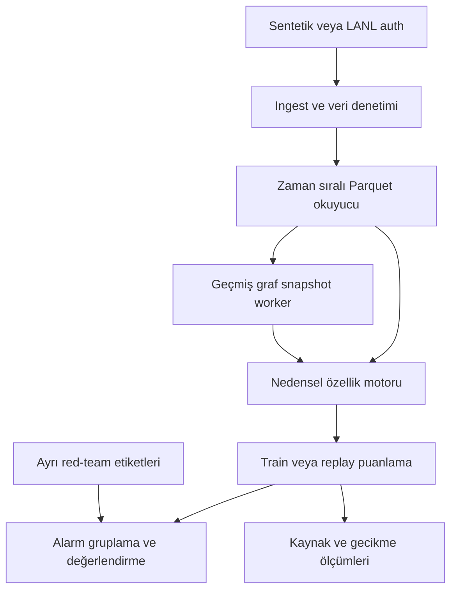

# Community-Aware Authentication Detection — Codex başlangıç dosyası

Hazırlanma / son güncelleme: **14 Ekim 2026**. Belge revizyonu: **3 — adım adım mentorluk ve uygulayarak öğrenme**. Hedef: ChatGPT 6 Astra ile planlama ve Codex ile birlikte öğrenerek uygulama. Bu dosya tek başına proje bağlamını taşır; önceki konuşmaların erişilebilir olması gerekmez. Birlikte verilen `README.md` proje köküne, `related_work.md` ise `docs/related_work.md` yoluna yerleştirilir.

**Çalışma biçimi:** Kullanıcı projenin uygulayıcısı ve karar vericisidir; Codex teknik mentor ve eşli çalışma ortağıdır. Bu dosya bütün projeyi otonom tamamlama emri değildir. Her seferinde tek küçük öğrenme/uygulama adımı üzerinde çalışılır; kullanıcının denemesi ve geri bildirimi görülmeden sonraki adıma geçilmez. Aşağıdaki uzun teknik listeler hedef sözleşmesidir; topluca çalıştırılacak iş listesi değildir.

**Durum:** Bu bir uygulama şartnamesidir. Henüz bu dosyaya dayanarak depo oluşturulmadı, veri indirilmedi, model eğitilmedi veya benchmark çalıştırılmadı. Aşağıdaki `authgraph` komutları Codex’in geliştireceği arayüz sözleşmesidir; ilgili aşama bitmeden çalışmaları beklenmez. Tahminler ve hedefler, ölçülmüş sonuç değildir.

## 1. Projenin amacı ve kapsamı

**Proje adı:** `community-aware-auth-detection`
**Python paketi / CLI:** `authgraph`
**Ana amaç:** Graf topluluklarını kullanarak kimlik doğrulama olaylarını puanlayan, geçmiş veriyi zaman sırasıyla yeniden oynatabilen, doğruluğu ve kaynak tüketimi birlikte ölçülen bir ML sistemi geliştirmek.

Araştırma sorusu:

> Ölçülen CPU ve bellek sınırları altında topluluk özellikleri, graf güncelleme sıklığı ve snapshot'ın kullanıma hazır olma zamanı; aynı alarm bütçesinde bilinen saldırı olaylarının yakalanmasını, uçtan uca gecikmeyi ve kaynak maliyetini nasıl etkiliyor?

Bu proje için kullanıcı profili: ML bilgisi var, biraz graf teorisi bilgisi var; siber güvenlikte başlangıç seviyesinde. Ana kariyer hedefi **ML systems engineering**. Kullanıcı yalnızca çalışan bir depo istemiyor: veriyi anlamaktan analiz ve işlemeye, model eğitim/değerlendirmeden sistemin tasarımı ve işletimine kadar kararları kendi verebilecek deneyimi kazanmak istiyor. Öğrenme planı bu hedefe göre sıralanacak. Bilinen ML kavramları gereksiz yere baştan anlatılmaz; eksikler adımın gerektirdiği ölçüde tamamlanır. Güvenlik alanındaki her konuyu öğrenmek ön koşul değildir.

Portföyde gösterilecek beceriler: veri sözleşmesi, parçalı veri işleme, nedensel özellik hesaplama, eğitim ve çıkarım tutarlılığı, model/snapshot sürümleme, durum yönetimi, yeniden başlatılabilir işleme, performans profilleme ve tekrarlanabilir deneyler. Proje özellikle üretim ML ve ML platform çalışmalarına uygundur. GPU kernel geliştirme veya dağıtık eğitim uzmanlığını tek başına kanıtlamaz.

### Mevcut çalışmalar ve projenin katkısı

Bu proje **yeni bir saldırı tespit algoritması veya bilimsel özgünlüğü kanıtlanmış yöntem** olarak konumlandırılmayacak. LANL authentication anomalisi, zamansal grafla lateral movement, topluluk bilgisiyle graf anomalisi ve Louvain ile topluluklar arası geçiş sinyalleri için öncül çalışmalar var.

| İlgili çalışma                         | Belgelenmiş ortak nokta                                             | Bu projede planlanan odak                                              |
| -------------------------------------- | ------------------------------------------------------------------- | ---------------------------------------------------------------------- |
| Jbeil [S14C]                           | LANL, zamansal graf, lateral movement                               | Açık topluluk özellikleri ve klasik modellerle kontrollü sistem deneyi |
| LANL Auth Redteam [S43]                | Auth/redteam dosyaları, Isolation Forest ve diğer anomali modelleri | Graf/topluluk katkısının aynı protokolde ayrıştırılması                |
| Lateral Movement Graph Detection [S44] | Kullanıcı/cihaz grafı, zaman pencereleri ve yol anomalileri         | Çok adımlı yol skoru yerine olay özellikleri ve snapshot yaşam döngüsü |
| ComGA [S45]                            | Topluluk bilgisini graf anomalisinde kullanma                       | GNN yerine geçmiş pencereli özellikler ve CPU odaklı replay            |
| Security Anomaly Detection [S46]       | Streaming/replay, ML baseline'ları, sistem altyapısı                | CICIDS2017 flow verisi yerine authentication grafı                     |
| Seerflow belgeleri [S47]               | Louvain toplulukları arasında geçiş alarmı                          | LANL üzerinde güncellik, tespit kalitesi ve kaynak maliyeti deneyi     |

Bu karşılaştırma kamuya açık README ve belgelere dayanır; depoların kodları çalıştırılarak doğrulanmadı. İncelenen kaynaklarda planın bütününü birebir doğrulayamadık; bu, dünyada benzeri olmadığına dair kanıt değildir. Bir özellik belgelerde görünmüyorsa “yok” değil “bu incelemede doğrulanmadı” denir.

**Hedeflenen katkı:** Tekrarlanabilir uygulama, nedensellik testleri, kontrollü B0–B4 karşılaştırması, graf güncelliği–kalite–maliyet ölçümü ve doğrulanmış recovery/profiling çalışması. Bunlar şu an hedef; ancak uygulama ve ölçüm tamamlandığında yapılmış katkı olarak yazılabilir. Sadece Louvain yerine Leiden kullanmak akademik yenilik iddiasına yetmez.

`docs/related_work.md` ayrıntılı karşılaştırmanın ve atıf/kod kullanım kaydının sahibidir. Bu dosya henüz klasörde yoksa Codex bu bölüm ve S14C/S43–S48 kaynakları üzerinden oluşturur; varsa mevcut içeriği koruyup günceller. Jbeil/ComGA'yı kurmak veya yeniden üretmek V1 ön koşulu değildir.

### V1 kapsamı

- LANL kimlik doğrulama kayıtları ve ayrı değerlendirme etiketleri.
- Aynı şemayı kullanan küçük, deterministik sentetik demo.
- Tek makinede CPU üzerinde çalışan Python uygulaması.
- Zaman pencereli özellikler, host-host grafı, Louvain ve Leiden karşılaştırması.
- Basit kurallar ve Isolation Forest karşılaştırmaları.
- Batch eğitim; durum tutan replay çıkarımı; kalite ve kaynak ölçümleri.
- CLI, testler, CI, İngilizce README ve Türkçe kullanıcı adımları.

**V1 dışında:** GNN, Kafka, Kubernetes, dağıtık feature store, gerçek kurumsal ağa bağlantı, otomatik engelleme, saldırı aracı, kapsamlı SIEM ürünü. Bunlar temel ölçümler ihtiyaç gösterirse sonraki sürümlerde ele alınabilir. Başlangıçta FastAPI servisi de zorunlu değildir; replay worker zaten anlamlı bir çıkarım sistemi örneğidir.

## 2. Codex ile çalışma ve öğrenme sözleşmesi

### Codex’e verilecek ilk mesaj

Aşağıdaki metni, bu dosyanın bulunduğu proje klasörünü Codex’te açtıktan sonra gönder:

```text
CODEX_PROJECT_START.md dosyasını baştan sona oku. Varsa README.md,
docs/related_work.md, AGENTS.md ve mevcut ilerleme notlarını da oku.

Bu projeyi benim yerime baştan sona yapmanı istemiyorum. Birlikte adım adım
ilerleyelim. Sen benim teknik mentorum ve eşli çalışma ortağımsın. Amacım
veriyi analiz etmeyi, işlemeyi, modeli kurup değerlendirmeyi ve ML sistemini
tasarlayıp ölçmeyi yaparak öğrenmek. ML bilgim var, biraz graf teorisi biliyorum;
siber güvenlik tarafında daha fazla açıklamaya ihtiyacım olabilir.

İlk yanıtında projenin ne yapacağını kısa bir auth olayı örneğiyle açıkla.
Gerekirse yalnızca bu klasördeki dosyaları ve mevcut Git durumunu salt okunur
incele. Eksik bilgi için kısa bir soru sorabilirsin; uzun seviye testi yapma.
Sonra sadece ilk küçük görevi ver: ortamı ve doğru proje dizinini tanımak.
Gerekli birkaç komutu, ne yaptıklarını ve çıktıda neye bakacağımı açıkla.
Ben çıktıyı veya denememi paylaşana kadar bekle.

İlk yanıtta tüm klasör yapısını oluşturma, paket kurma, git init/commit yapma,
sentetik veri üreticisini yazma veya M0/M1'i topluca tamamlama.

Her adımda: amaç ve gerekli kavram -> küçük örnek -> benim yapacağım tek görev
-> benim denememi inceleme -> test/yorum -> kısa öğrenme notu döngüsünü uygula.
Önce denememe fırsat ver. Takılırsam önce hedefli ipucu, sonra gerekirse kısmi
örnek ver. Tam çözümü istediğimde ver ve neden çalıştığını birlikte inceleyelim.
Kodu benim için yazmanı istersem yalnızca o açıkça seçtiğimiz adımı uygula;
bunu sonraki aşamaları da yapma yetkisi olarak yorumlama.

Bir adımın çalışan sonucu ve benim anlayışım birlikte gözden geçirilmeden
sonraki adıma geçme. Ben "devam" dediğimde sıradaki tek küçük adıma geç;
milestone veya projeyi otomatik tamamlamaya başlama.

Önceki AGENTS.md veya başka proje notlarında otonom tamamlama talimatı varsa
bu öğrenme tercihimle çelişen kısmı belirt; ilk belge düzenleme adımında birlikte
güncelleyelim. Teknik veri/test/atıf kuralları geçerli kalır.

Türkçe öğret; terimleri İngilizceleriyle ilişkilendir. Kod isimleri İngilizce
olsun. Teknik seçimin nedenini, alternatifini ve yanlış olabileceğini nasıl
anlayacağımızı anlat. Sonuç uydurma ve benim yerime çalıştırmadığın bir komutu
çalıştırılmış gibi gösterme. Her yanıtta sıradaki tek somut görevimi açık yaz.
```

### Sonraki oturumlarda devam mesajı

```text
CODEX_PROJECT_START.md, varsa AGENTS.md, TASKS.md, STATUS.md,
docs/learning_log.md, README.md ve docs/related_work.md dosyalarını oku.
Birlikte öğrenme modunda devam edelim. Önce en son yaptığımız küçük adımı,
benim takıldığım yeri ve eldeki kanıtı hatırlat. Dosyalar eksikse tamamlandı
varsayma. Gerekirse en fazla bir kısa soruyla mevcut noktayı netleştir.

Sıradaki tek küçük görevi seç. Kavramı ve nedenini açıkla; benim denememi bekle.
Milestone'u kendi başına tamamlama. Kod yazmanı veya komut çalıştırmanı açıkça
istersem yalnızca o adımı yap, sonucu açıklayarak bana geri ver.
İlerleme ve öğrenme notlarını güncelleme zamanı geldiğinde birlikte kaydedelim.
```

### 2.1 Roller ve uygulama sınırı

- **Kullanıcı:** Veriyi inceler, tahmin üretir, kod/SQL/komut denemesi yapar, sonuç yorumlar ve tasarım kararını gerekçelendirir. Her satırı tek başına yazmak zorunda değildir; yardımın derinliğini seçebilir.
- **Birlikte ulaşılacak teknik hedef:** Konuyu açıklar, işi küçük parçalara ayırır, kaynak bölümünü seçer, denemeyi inceler, hedefli ipucu verir, test/hata ayıklama konusunda rehberlik eder. Yanlış varsayımı açıkça düzeltir.
- **Varsayılan:** Uygulama komutunu kullanıcı çalıştırır; Codex sonucu yorumlar. Salt okunur dosya incelemesi ve mevcut kodu değerlendirme yardımcı çalışma kapsamındadır.
- **Açık devir:** “Bu fonksiyonu sen yaz” veya “bu testi sen çalıştır” gibi istek yalnızca o adıma uygulanır. Seçilen adım içindeki rutin, geri alınabilir düzeltmeler için her satırda yeniden izin sorulmaz; sonraki öğrenme adımına geçerken kullanıcıya dönülür.
- **Git:** İlk init/branch/stage/commit akışını kullanıcı açıklamalarıyla uygular. Sonraki commit'ler de birlikte incelenen bir adım olur; arka planda otomatik commit zinciri oluşturulmaz. Remote/push ayrı kullanıcı seçimidir.
- **Hız tercihi:** Kullanıcı bildiği bir bölümü atlayabilir veya geçici olarak yardım miktarını artırabilir. “Devam” ifadesi öğrenme modunu kapatmaz. Çalışma biçimi yalnızca açık bir tercihle değiştirilir.

### 2.2 Her küçük adımın yanıt biçimi

1. **Bugünkü amaç:** Tek bir beceri ve beklenen küçük çıktı; örneğin “100 satırlık auth örneğinde null oranını hesaplayıp yorumlamak”.
2. **Kavram ve neden:** İş için gerekli açıklama, sade örnek ve teknik terim. Detayı mevcut bilgiye göre artır; bütün teoriyi aynı yanıta yükleme.
3. **Benim görevim:** Tek net görev; gerekli olduğunda birkaç bağlantılı komut veya küçük kod iskeleti. İstenmedikçe görevin tamamlanmış çözümünü aynı yanıtta verme.
4. **Nasıl kontrol edeceğim:** Beklenen çıktı türü, değişmezler, olası hata belirtileri; gerçek veride gözlenmemiş sayıları beklenen sonuç diye uydurma.
5. **Burada bekle:** Kullanıcının kodunu, çıktısını veya yorumunu aldıktan sonra incele. Henüz yanıt yokken ikinci görevi uygulama.

Kullanıcı cevap verdikten sonra doğru kısmı ve varsa hatayı somut olarak belirt. Bir komutun başarılı exit vermesi, veri/istatistik yorumunun doğru olduğunu kanıtlamaz. Gerekirse aynı adımda küçük bir düzeltme denemesi yap; doğruysa bir cümleyle “ne öğrendik?” notu al ve sıradaki adımı öner. Zorunlu uzun sınav veya her adımda tekrar eden izin soruları oluşturma.

### 2.3 Yardım ve hata ayıklama

Önce hatanın hangi katmanda olduğunu ayır: ortam/bağımlılık, veri şeması, zaman semantiği, algoritma, değerlendirme veya kaynak tüketimi. Kullanıcıdan yalnızca gerekli küçük hata/çıktı bölümünü iste. Gerçek kayıtların ve sırların paylaşılmasını isteme; sentetik veya küçültülmüş örnek kullan.

Yardım sırası esnektir: kavramsal ipucu -> ilgili satırı gösterme -> küçük iskelet -> birlikte düzeltme -> istenirse tam çözüm. Kullanıcı doğrudan açıklama veya tam çözüm istediğinde bunu yapay biçimde saklama. Çözümden sonra benzer küçük bir değişikliği kullanıcının yapmasını öner; bu zorunlu sınav değildir.

### 2.4 İlerleme kaydı

Teknik tamamlanma ile öğrenme durumunu ayrı tut. Her görev için `not_started / in_progress / verified / blocked` teknik durumu ve `not_discussed / needs_practice / can_explain_and_modify` öğrenme durumu kullanılabilir. Öğrenme durumu kullanıcıyla değerlendirilir; Codex “anladın” diye otomatik işaretlemez.

`STATUS.md` şunları taşır: güncel mikro-adım, kullanıcının denemesi, gerçekten doğrulanan sonuç, takıldığı kavram, beklenen kullanıcı eylemi, yardım düzeyi ve sıradaki öneri. `docs/learning_log.md` içinde kavram, kendi açıklamam, denediğim çözüm, hata/kanıt ve tasarım gerekçesi tutulur. Kullanıcının henüz yazmadığı düşünceler onun ağzından uydurulmaz.

### 2.5 İlk oturumun küçük sınırı

İlk etkileşimde yalnızca proje amacı ve ortam/dizin gözlemi ele alınır. Örneğin mevcut shell'e uygun `pwd`, `git --version`, `python3 --version`, `uv --version` komutlarının neyi gösterdiği açıklanır. `git rev-parse --show-toplevel` yalnızca Git varsa kullanılır; repo dışında hata vermesinin anlamı anlatılır. Kurulu olmayan araç aynı yanıtta otomatik kurulmaz.

Kullanıcı çıktıyı paylaştığında ikinci adım doğru proje dizinini ve kurulum gereksinimini seçmek olabilir. Sonraki bir adımda Git/ortam, bir başkasında öğrenme sözleşmesini `AGENTS.md` içine taşımak ele alınır. **İlk oturum için M0 veya M1'i bitirme zorunluluğu yoktur.**

## 3. Değişmez mühendislik kuralları

1. **Gelecek bilgisi yok:** `t` anındaki özellikler yalnızca zamanı `t`'den küçük olaylara dayanır. Eğitim satırlarının özellikleri de bu kurala uyar.
2. **Aynı saniye atomik:** Aynı saniyedeki olayların tümü aynı geçmiş durumundan puanlanır; sonra durum topluca güncellenir. Dosya batch sınırları bu kuralı bozamaz.
3. **Etiketler çıkarımdan ayrı:** Red-team tablosu inference, feature veya graf oluşturma yoluna giremez. Etiketler yalnızca denetim/değerlendirmede kullanılır.
4. **Etiketsiz, kesin normal değildir:** Gerçek veride `known_positive` ve `unlabeled` ayrımı yapılır. Kaynağın doğrulamadığı benign etiketleri oluşturulmaz.
5. **Zamansal değerlendirme:** Rastgele train/test ayırımı yapılmaz. Dönüşümler ve model yalnızca eğitim bölümünde fit edilir.
6. **Tek özellik uygulaması:** Offline özellik üretimi ve replay aynı `FeatureEngine` kodunu kullanır.
7. **Kaynak bütçesi ölçülür:** Gzip dosyasının veya tüm olayların RAM'e yüklenmesi yasaktır. Grafın kendisi de RAM'e sığmalıdır; pencere ve pilot ölçümü olmadan ölçek varsayılmaz.
8. **Topluluk ID'si kategorik kimliktir:** Sayısal büyüklük olarak modele verilmez; her snapshot'ta değişebileceği kabul edilir.
9. **İddialar ölçümle sınırlı:** Sentetik başarı gerçek saldırı başarısı değildir. Eksik veriyle üretim seviyesi veya tam LANL benchmark iddiası yapılmaz.
10. **Veri depoya girmez:** Gerçek ham veri, işlenmiş olaylar, kullanıcı/host listeleri, sırlar, büyük model dosyaları Git'e eklenmez. Küçük sentetik fixture'lar istisnadır.
11. **Tekrarlanabilirlik:** Veri checksum'ı, kod commit'i, bağımlılıklar, config, seed, model ve graf sürümleri sonuçla birlikte tutulur.
12. **Mevcut kullanıcı çalışması korunur:** `reset --hard`, `clean -fd`, force push, izinsiz geçmiş yeniden yazımı veya ilgisiz dosyaların değiştirilmesi yapılmaz.
13. **Özgünlük ve atıf:** İlgili yöntemler ve depolar açıkça belirtilir. “İlk”, “state-of-the-art”, “production-ready” ve üstünlük iddiaları uygun kanıt olmadan yazılmaz. README'deki planned/implemented/measured ayrımı korunur.
14. **Kod kökeni:** Dış kod alınırsa upstream, commit/sürüm, dosya, lisans, yapılan değişiklikler ve doğrulama `docs/related_work.md` içinde kaydedilir. Kamuya açık repo otomatik yeniden kullanım izni değildir; lisans kontrolü atfın yerine veya atıf lisansın yerine geçmez. [S48]
15. **Öğrenme önceliği:** Aşağıdaki mimari, komutlar ve milestone hedefleri Bölüm 2'deki birlikte çalışma sözleşmesiyle uygulanır. Kod üretmek veya testleri geçirmek, kullanıcının denemesi ve birlikte inceleme adımının yerine geçmez. Bir sonraki göreve otomatik geçilmez.

## 4. Mimari ve teknoloji seçimi



Okuyucu olayları açıkça `(event_time_s, event_id)` sırasıyla verir. Parquet dosya sırasına güvenilmez. Graf worker yalnızca yayınlanmış geçmiş snapshot'ları sunar. Değerlendirme modülü etiketleri son aşamada ekler.

| Bileşen        | Başlangıç seçimi                               | Gerekçe                                                                                 |
| -------------- | ---------------------------------------------- | --------------------------------------------------------------------------------------- |
| Python         | 3.12 başlangıç adayı                           | Platform/wheel uyumluluğu kurulumda doğrulanır; uyumsuzluk varsa gerekçeli değiştirilir |
| Paket yönetimi | uv, pyproject.toml, uv.lock                    | Ortamı ve bağımlılık çözümünü tekrar kurabilmek                                         |
| Veri           | PyArrow, Parquet, DuckDB                       | Batch yazımı, bölümlü okuma ve disk destekli sorgulama                                  |
| Graf           | igraph + leidenalg; NetworkX Louvain referansı | Leiden uygulaması ve anlaşılır karşılaştırma                                            |
| ML             | NumPy, scikit-learn                            | Baseline ve güvenilir model API'leri                                                    |
| CLI / config   | argparse + PyYAML                              | Başlangıç için az bağımlılık; config doğrulaması şart                                   |
| Kalite         | pytest, Ruff                                   | Davranışsal doğruluk ve kod tutarlılığı                                                 |
| Ölçüm          | perf_counter, psutil                           | Monotonik süre ve süreç kaynakları                                                      |
| CI             | GitHub Actions                                 | Gerçek veri indirmeden sentetik akışın doğrulanması                                     |

Sürümleri bu belgeye tahminen sabitleme. Codex uyumlu sürümleri çözer, `uv.lock` üretir, kurulum ve smoke testini çalıştırır. İlerleyen adımlarda bağımlılıkları ihtiyaç geldikçe ekler. Yerel ortamda GPU veya Docker bulunduğu varsayılmaz.

## 5. Veri kaynakları ve veri sözleşmesi

### 5.1 Ana veri: LANL Cyber1

[LANL Cyber1][S01], 58 günlük anonimleştirilmiş çok kaynaklı kayıttır. V1 yalnızca `auth.txt.gz` ve `redteam.txt.gz` kullanır. Resmî sayfada sıkıştırılmış boyutlar yaklaşık 7.2G ve 4.8K olarak verilir. Diğer kaynaklar başlangıçta gerekli değildir. Zaman, 1'den başlayan göreli saniyedir; gerçek takvim tarihi değildir. Eksik alanlar `?` ile gösterilir. Başarısız doğrulamalar, veri içinde başarılı doğrulaması bulunan kullanıcılarla sınırlıdır. Bu seçim yanlılığı raporda belirtilir.

Veri herkese açık erişimlidir; “açık kaynak kod lisansı” ile veri kullanım koşulları aynı şey değildir. Kaynağın lisans/atıf bilgisini `DATA_SOURCES.md` içine kaydet. Resmî indirme sayfasındaki e-posta ve kullanım amacı alanlarını kullanıcı doldurur. Agent kimlik veya e-posta uydurmaz. Dosyalar yoksa sentetik akışla devam eder.

**İlk gerçek veri denemesi:** Dosyayı stream ederek ilk N geçerli satırı veya belirlenmiş kesintisiz zaman aralığını işleyebilirsin. Rastgele auth satırı örnekleme, davranış grafını bozduğu için ana deney yöntemi değildir. Başlangıç diliminde saldırı bulunmayabilir; bu dilim yalnızca ingest/performans denemesidir.

### 5.2 Kanonik auth şeması

| Alan                   | Tip / anlam                                        |
| ---------------------- | -------------------------------------------------- |
| event_id               | Kalıcı ve deterministik kaynak satırı kimliği      |
| event_time_s           | int64, göreli saniye, en az 1                      |
| src_user / dst_user    | Null olabilir; `user@domain` alanları ayrı korunur |
| src_host / dst_host    | Null olabilir; kaynak ve hedef bilgisayar          |
| auth_type              | Kaynaktaki kimlik doğrulama türü                   |
| logon_type             | Kaynaktaki oturum türü; zorla integer'a çevrilmez  |
| orientation            | Kaynaktaki yön/olay bağlamı                        |
| result                 | Denetlenmiş success/failure/unknown sözlüğü        |
| source_id / source_row | Dosya kimliği ve fiziksel satır numarası           |
| relative_day           | `(event_time_s - 1) // 86400`, sıfır tabanlı gün   |

`actor_user` başlangıçta `src_user` olarak türetilir. Bu seçimin olay semantiği ve etiket eşleşmesiyle uyumu M2'de incelenir. Alan değişirse adapter/feature şeması sürümlenir. Kaynak kullanıcı ile hedef kullanıcı sessizce birleştirilmez.

Kaynak dosyanın SHA-256'sı bir streaming geçişte hesaplanır. `source_id`, dataset namespace ve bu checksum'dan; `event_id`, `source_id` ve fiziksel satır numarasından türetilir. İlk geçişin I/O maliyeti kaydedilir. Kaynak manifestindeki indirme zamanı event kimliğini değiştirmez. Fiziksel olarak tekrarlanan satırlar ayrı olaylar olarak korunur. Aynı olayın yeniden teslim edilmesi ise aynı `event_id` ile tanınır. Yeniden sıkıştırılmış bir dosyanın byte checksum'ı değişirse yeni kaynak sayıldığı belgelenir.

### 5.3 Ingest ve kalite denetimi

1. Gzip'i streaming aç; açık şema ve sınırlı batch kullan.
2. Sütun sayısı, zaman, boş değerler ve enum dağılımlarını denetle.
3. Hatalı satırları neden koduyla karantinaya al; toplam/başarılı/hatalı sayılar tutarlı olsun.
4. `?` değerlerini null'a dönüştür; tüm bilinmeyen host'ları tek graf düğümünde birleştirme.
5. Parquet'i `relative_day` üzerinden bölümlendir; küçük dosya patlamasını önle.
6. Sıralılık ve duplicate oranını raporla. Gerekirse disk destekli sıralama yap.
7. Çıktıyı geçici dizinde tamamlayıp atomik olarak yayınla; başarısız run'ı tamamlanmış gösterme.
8. Schema version, satır sayıları, zaman aralığı, checksum, kullanılan parser sürümü ve çalışma süresini manifest'e yaz.

DuckDB bellek sınırı tek başına toplam süreç RSS sınırı değildir. Arrow buffer'ları, Python nesneleri, graf kopyaları ve diğer worker'lar ayrıca hesaba katılır. Temp disk alanını da ölç. [S09], [S20]

### 5.4 Etiket eşleştirmesi

Red-team tablosunun alanları: zaman, kullanıcı, kaynak host, hedef host. İki aday eşleştirme ayrı ayrı denetlenir:

- `(time, src_user, src_host, dst_host)`;
- `(time, dst_user, src_host, dst_host)`.

Sıfır/tek/çoklu eşleşmeleri, iki yöntemin farklarını ve kapsamını raporla. Daha çok pozitif bulmak için iki join'i sessizce OR ile birleştirme. Şema açıklaması ve audit sonucuna göre bir politika seç; `docs/decisions/002-label-mapping.md` içine dondur. Belirsizlik sürerse belirsiz kayıtları ayrı tut.

Bir pozitif anahtar birden fazla fiziksel auth satırıyla eşleşebilir. Metrikleri satır çoğalmasıyla şişirme: birincil değerlendirme benzersiz etiket anahtarı üzerinden yapılır. Eşleşmeyen etiketleri normal sınıfına çevirme. Eşleşen pozitifler üzerindeki recall ile toplam etiket eşleştirme kapsamını ayrı raporla. Gerçek veride etiketlenmemiş saldırılar bulunabileceğinden klasik precision/FPR iddialarından kaçın.

## 6. Graf teorisini nasıl uygulayacağız?

### 6.1 İki temsil

**Olay akışı:** Yönlü, zaman damgalı auth olayları; tüm alanları korur.

**Topluluk grafı:** Host düğümleri, geçmişteki başarılı host-host auth ilişkilerinden oluşan yönsüz ağırlıklı graf. Eksik uçlar ve self-loop'lar bu grafın dışında kalır. Başarısız veya self-login olayları diğer davranış özelliklerinden silinmez.

`T` cutoff'ında graf yalnızca `[T-W, T)` aralığını kullanır. Başlangıçta `W = 86400` saniye ve snapshot yenileme aralığı `3600` saniye. Kenar ağırlığı:

```text
w(i,j) = log1p(count(i -> j) + count(j -> i))
```

Ham count ağırlığı bir ablation'dır. Bu yönsüzleştirme ve log dönüşümü proje tasarım kararıdır; güvenlik açısından optimal olduğu varsayılmaz. Derece/strength tanımlarında kullanılan graf açıkça belirtilir.

### 6.2 Louvain ve Leiden

Louvain: yerel topluluk hareketleri ve grafın küçültülmesiyle modularity optimizasyonu için baseline. Leiden: ek refinement adımı bulunan karşılaştırma. Leiden'ın topluluk bağlantısına ilişkin özellikleri, saldırı tespit başarısını veya global optimumu garanti etmez. Modularity çözünürlük sınırı ortadan kalkmış sayılmaz. [S10], [S11]

Leiden başlangıç API sözleşmesi:

```python
partition = leidenalg.find_partition(
    graph,
    leidenalg.RBConfigurationVertexPartition,
    weights="weight",
    resolution_parameter=1.0,
    seed=42,
    n_iterations=2,
)
```

Bu örnek uygulamada kurulu paketle doğrulanacak. `ModularityVertexPartition` sınıfına aynı resolution parametresini taşımak doğru değildir. CPM başka bir amaç fonksiyonudur; aynı deney gibi sunulmaz. [S12]

Louvain/Leiden karşılaştırmasında graf, ağırlıklar ve generalized modularity çözünürlüğü aynı olsun. Ham objective değerleri farklı normalizasyonla gelebilir; ortak bir modularity hesaplamasıyla raporla. NetworkX ile C++ tabanlı uygulamaları süre bakımından karşılaştırırken sonucun algoritma + uygulama + veri yapısı birleşimini ölçtüğünü belirt. Daha sonra aynı backend karşılaştırması eklenebilir.

### 6.3 Snapshot yaşam döngüsü

Her snapshot şu bilgileri içerir: ID, pencere başlangıcı, veri cutoff'ı, config hash, düğüm/kenar sayısı, partition, algoritma/seed/objective, hesaplama süresi ve yayın zamanı.

Topluluk numaraları snapshot'lar arasında kalıcı değildir. Kullanıcı-topluluk frekanslarını önceki ID'lerle sürdürme. Kullanıcının pencere içindeki host geçmişini saklayıp yeni partition'a yeniden eşleştir veya eşdeğer doğrulanmış bir yöntem kullan. Bu yeniden eşleştirmenin maliyetini benchmark'a kat. Toplulukları yeniden numaralandırmak tahminleri değiştirmemeli.

**İlgili çalışma sınırı:** Topluluklar arası geçişi risk sinyali olarak kullanmak Seerflow belgelerinde de anlatılır [S47]; community-aware anomaly detection için ComGA öncülüdür [S45]. Cross-community özelliğini yeni bir yöntem diye adlandırma. Bizim ölçmek istediğimiz, bu tür özelliklerin belirli veri/protokoldeki ek faydası ve işletim maliyetidir.

## 7. Özellikler ve model karşılaştırması

Tüm sayaçlar `t` öncesindeki tanımlı pencereden hesaplanır. Destekleyici kısa pencereler: 5 dakika, 1 saat, 24 saat. Görülmeyen/eksik değerler için açık bayraklar kullan.

| Deney | Özellik/model                                  | Test ettiği katkı               |
| ----- | ---------------------------------------------- | ------------------------------- |
| B0    | Deterministik novelty kuralı                   | Karmaşık modele ihtiyaç var mı? |
| B1    | Isolation Forest + zamansal tabular özellikler | Basit ML referansı              |
| B2    | B1 + host ilişki/graf özellikleri              | İlişki yapısının katkısı        |
| B3    | B2 + Louvain topluluk özellikleri              | Louvain katkısı                 |
| B4    | B2 + aynı tür Leiden topluluk özellikleri      | Leiden katkısı                  |

**B0 başlangıç skoru:** `2 * new_user_dst_24h + new_src_dst_24h + fail_ratio_user_1h`. Bu katsayılar başlangıç tasarımıdır; doğrulanmış güvenlik kuralı değildir. Tanımsız geçmişte fail ratio 0 ve ayrıca cold-start bayrağı tutulur. Eşit skorlarda deterministik event/alarm anahtarıyla tie-break yapılır.

**B1:** Kullanıcı-hedef yeniliği, kullanıcı başına farklı hedef sayısı/5dk, auth sayısı/5dk ve 1sa, failure ratio/1sa, kullanıcı-hedef son görülme süresi. Son görülme yalnızca saklanan pencere içinde bilinir; daha eski veya bilinmeyen için capped değer + missing/cold bayrağı kullanılır. Kullanıcı/host ID'lerini ham kategorik ezberleme özelliği olarak ekleme.

**B2:** Kaynak-hedef kenar yeniliği, geçmiş kaynak/hedef derece ve ağırlıklı strength, host çiftinin geçmiş frekansı. Derece özellikleri için güncel pencere sayacı mı yoksa son snapshot mı kullanıldığı şemada açık olsun; başlangıçta son snapshot kullan ve yaşını ekle.

**B3/B4:** Kaynak ve hedef aynı toplulukta mı, hedef topluluk büyüklüğü, kullanıcının bu topluluğa geçmiş erişim sayısı, yeni topluluk bayrağı, topluluk sürprizi, snapshot yaşı ve bilinmeyen uç bayrakları.

```text
surprise(u,c) = -log((N(u,c) + alpha) / (N(u) + alpha*K))
```

`alpha=1` başlangıç tercihidir. Sayımlar aynı geçmiş pencereye ve aynı partition'a göre hesaplanır. `K`, mevcut topluluklar + ayrı UNKNOWN kovasıdır; `N(u)` bu kovalar üzerindeki toplamdır. Eksik actor için kullanıcı olasılığı üretmek yerine missing bayrağı ve tanımlı fallback kullan. UNKNOWN kovası bir graf düğümü değildir.

Isolation Forest için `risk = -model.score_samples(X)`; büyük skor daha anormaldir. Bu bir saldırı olasılığı değildir. Başlangıçta `n_estimators=100`, `max_samples=256`, `random_state=42`, `contamination="auto"` değerlendirilebilir; alarm eşiği ayrıca validation üzerinde belirlenir. Eğitim verisinin tamamen temiz olduğu varsayılmaz. [S13]

Büyük train bölümünde, önce bütün geçmişten nedensel özellikleri üret; sonra bu özellik satırlarından seed'li sınırlı reservoir örneklemesiyle model eğit. Rastgele ham olay seyrelterek graf geçmişini değiştirme. İmputer/encoder gibi dönüşümler sadece train'de fit edilir. Fit edilmiş modeller test boyunca sabittir; etiketsiz geçmiş durumunun nedensel güncellenmesi devam edebilir.

## 8. Replay ve ML systems uygulama sözleşmesi

### 8.1 Tek durum motoru

Önerilen arayüzler:

```python
events = reader.next_timestamp_group()
state.expire_before(events.timestamp - max_window_s)
snapshot = snapshots.latest_available(clock)
features = feature_engine.transform_before_observe(events, state, snapshot)
scores = scorer.score(features)
sink.write_idempotent(scores)
feature_engine.observe_group(events, state)
checkpoint.commit_at_group_boundary()
```

Bu pseudocode bir işlem sözleşmesidir; çıktının ve state'in atomikliği ayrıca tasarlanır. Pencere `[t-W,t)` olduğundan `t-W` anındaki olay korunur; yalnızca daha eskiler silinir. Hiçbir `transform` çağrısı state'i ilerletmez. Boş graf ve ilk kez görülen kullanıcı/host geçerli durumlardır.

### 8.2 İki farklı replay modu

- **Deterministik/nedensel mod:** Olay zamanı ilerletilir; snapshot hesaplaması cutoff noktasında tamamlanır. Causal correctness ve offline/replay parity için kullanılır. Duvar saati maliyeti ayrıca ölçülür; gerçek zaman SLA sonucu olarak sunulmaz.
- **Operasyonel mod:** Olaylar belirtilen hızla sisteme verilir; snapshot worker gerçekten asenkron çalışır. Yeni snapshot ancak tamamlandıktan ve yayınlandıktan sonra kullanılabilir. Önceki snapshot ile hizmet sürer; snapshot yaşı ve kaçırılan yenilemeler ölçülür.

`event_time_s` ile `perf_counter()` doğrudan karşılaştırılamaz. Replay scheduler olay zamanını başlangıç duvar saati ve hız katsayısıyla eşler. Kuyruk/giriş/çıkış süreleri monotonik duvar saatindedir. Snapshot üzerinde hem veri cutoff'ı hem operasyonel yayın zamanı bulunur. Kuyruk gecikmesi ve model hesaplama süresi ayrı kaydedilir.

### 8.3 Durum, checkpoint ve kapasite

- TTL'li olay kuyrukları/sayaçları; zaman aşımıyla sıfırlanan anahtarlar temizlenir.
- “Şimdiye kadar görülen tüm çiftler” gibi sınırsız set oluşturulmaz; yenilik pencereye göre tanımlanır.
- TTL tek başına sabit RAM garantisi değildir: olay hızı ve aktif anahtar sayısı artınca bellek artar. Bütçe ihlali görünür hata veya belgelenmiş backpressure üretir; sessiz olay düşürmez.
- Checkpoint: giriş cursor'ı, state, aktif snapshot/model sürümleri ve çıktı ilerleme noktası. İlk sürüm yalnızca tamamlanmış saniye grupları arasında checkpoint alabilir.
- Çökmeden sonra tekrar okunan olaylar state'e iki kez eklenmemeli; sink de `(run_id,event_id,model_version)` gibi açık bir idempotency anahtarı kullanmalı.
- Dosya çıktısı için atomik batch yayınlama + commit manifest'i gibi basit bir protokol seç; süreç tam ortasında kesilerek doğrula. Sadece çıktı dedup etmek state'in iki kez sayılmasını çözmez.
- İlk sürüm sıralanmış geçmiş veri bekler; sıra dışı olayda açık hata verir. Watermark/geç olay politikası V2 işidir.

### 8.4 Ölçülecek performans

İşlenen olay/saniye, toplam süre, scoring p50/p95/p99, uçtan uca p50/p95/p99, backlog, snapshot süresi, snapshot yaşı, state anahtar sayısı, peak RSS, CPU zamanı, disk kullanımı. Child process'ler dahil kaynakları raporla; yalnızca ana süreci ölçme.

Gecikme histogramının tüm örneklerini RAM'de biriktirme; histogram veya kontrollü örnekleme kullan. Maksimum kapasite testi ile gerçek zaman hızlandırılmış replay testini ayır. “Sürdürülebilir throughput” yalnızca backlog sürekli büyümüyorsa ve olay düşmüyorsa kullanılır. Donanım, thread sayısı, süreç sayısı ve veri büyüklüğü raporda yazılı olsun.

## 9. Değerlendirme tasarımı

### 9.1 Zaman bölümleri

Önce veri ve etiketlerin zamansal kapsamını denetle; ardından train/validation/test sınırlarını dondur. Son günlerde pozitif yoksa otomatik “son 10 gün test” seçme. Sınırları performansı iyileştirmek için tekrar tekrar oynatma. Pozitif bulunmayan bölümlerde ilgili metrik `NA` olsun.

Train öncesinde mümkünse tam 24 saat warm-up kullan. Yeterli geçmişi olmayan olaylar cold-start olarak etiketlenir; birincil metriğe giren/girmeyen sayılar açıkça raporlanır. Validation/test başlangıcında geçmiş state nedensel olarak taşınabilir. Model fit zamanından sonraki veri eğitim örneklerine veya preprocessing'e karışamaz.

Config ve eşikler validation'da seçilir; test bir kez nihai değerlendirme için açılır. Seyrek pozitifler nedeniyle sonuç belirsizliği ve veri kapsamı açık yazılır. Veri setinin yaşı ve tek kurumdan gelmesi genelleme sınırıdır.

### 9.2 Alarm birimi

Başlangıç alarm anahtarı: `(actor_user, dst_host, (t-1)//300)`. Eksik actor/host kayıtlarında yanlış birleşmeyi önlemek için event kimliği tabanlı ayrı fallback kullan. Her grubun skoru maksimum olay riskidir; en yüksek skoru üreten olay referansı tutulur. Grup, 5 dakikalık pencere kapanınca çıkar; bu bekleme tespit gecikmesine dahildir.

Bir pozitif etiket anahtarı en fazla bir kez yakalanmış sayılır. Aynı alarm birden fazla pozitif anahtarı içerebilir; **pozitif alarm sayısı** ile **yakalanan pozitif anahtar sayısı** ayrı sayaçtır.

### 9.3 Raporlanacak kalite

| Ölçüm                        | Tanım / sınır                                                                                                                          |
| ---------------------------- | -------------------------------------------------------------------------------------------------------------------------------------- |
| Known-positive recall@B      | Günlük ilk B alarm içinde yakalanan benzersiz, eşleşmiş ve değerlendirmeye uygun pozitif anahtar / aynı kapsamdaki tüm pozitif anahtar |
| Known-positive alert yield@B | En az bir bilinen pozitif içeren seçilmiş alarm / seçilmiş alarm sayısı; gerçek precision iddiası değildir                             |
| Label match coverage         | Auth'a eşleşen benzersiz red-team anahtarı / denetlenen red-team anahtarı                                                              |
| Eligibility coverage         | Warm-up/split/filter sonrasında değerlendirmeye giren pozitifler ve olayların kapsamı                                                  |
| Alert rate                   | Online sabit eşikle üretilen alarm/gün                                                                                                 |
| Detection delay              | Pozitif olaydan alarm çıkışına gecikme; grup kapanışı ve kuyruk dahil                                                                  |
| Kaynak maliyeti              | Bölüm 8.4'teki ölçümler                                                                                                                |

Başlangıç alarm bütçeleri `B ∈ {10, 50, 100}`. Günlük top-B sıralaması **retrospektif değerlendirmedir**; günün gelecekteki skorlarını bilmeyen online sistemle aynı değildir. Online mod için validation'da belirlenmiş sabit threshold kullan; gerçekleşen alarm hızını raporla. Skoru gün sonunda sıralayarak online SLA iddia etme.

Seçilen alarm sayısı `min(B, aday alarm sayısı)`dır. Payda sıfırsa sonuç `NA`; sıfır başarı yazılmaz. Toplam recall için günlerin pay/paydasını topla; ayrıca günlük dağılımı göster. AP istenirse etiketsizlerin negatif kabul edildiği **proxy AP** olarak ver; `average_precision_score` ile trapezoidal PR-AUC'yi aynı metrik sayma. [S16]

İlk deneyde B0–B4, aynı veri/split/aday olaylar üzerinde çalıştırılır. Sonra tek değişkenli ablation: raw/log ağırlık, 6/24/72 saat graf penceresi, 15dk/1sa/4sa refresh veya resolution 0.5/1/2. Tam kombinasyon taramasını baştan çalıştırma. Seçilen birkaç ayarı ek seed'lerle incele; tüm tekrarları ve olumsuz sonuçları koru.

Topluluk özellikleri katkı sağlamazsa bu geçerli sonuçtur. Ölçülmüş maliyet-kalite ilişkisi ve doğru sistem tasarımı, portföyün önemli çıktılarıdır.

### 9.4 Öncelikli güncellik ve maliyet deneyi

İlk B0–B4 tablosu çıktıktan sonra ana sistem deneyi **15dk / 1sa / 4sa snapshot refresh** karşılaştırmasıdır. Graf penceresini başlangıçta 24sa tut; aynı ağırlık dönüşümü, aynı split, aynı aday olaylar/alarm grupları ve aynı donanım ayarlarıyla ilerle. Gerçekleşen snapshot yaşı ve güncelleme süresini kaydet; istenen aralığın gerçekten sağlandığını varsayma.

- **Eşleşmiş eğitim deneyi:** Her refresh konfigürasyonu için o politika ile nedensel train özellikleri üret ve aynı model hyperparametreleriyle ayrı model fit et. Validation seçimi testten önce dondurulur. Config/model sürümleri ayrıdır.
- **Sabit model stres deneyi (opsiyonel):** Eğitilmiş modeli değiştirmeden snapshot yayınını geciktir. Bu, servis sırasında stale özellik ve dağılım uyumsuzluğu etkisini ölçer; eşleşmiş eğitim deneyiyle aynı sonuç grubuna karıştırma.
- **Operasyonel ölçüm:** Snapshot hesaplama/yayınlama zamanı, worker kaynakları, state yeniden eşleme maliyeti ve kuyruk gecikmesi dahildir. Giriş hızını kaldıramayan koşulları başarısız/kararsız diye raporla; olay düşürerek hızlı görünme.
- **Tekrarlar:** Doğruluk ve kalite deneylerinde seed/config kaydedilir; operasyonel zamanlamanın tekrarlar arasında değişebileceği kabul edilir. Deterministik moddaki birebir parity şartını asenkron duvar saati zamanlamasına yanlış uygulama; operasyonel modda nedensellik/yayınlama kuralları ve ölçümlerin dağılımı doğrulanır.

İlk raporun sütunları: variant, refresh, veri/split/model ID, etiket kapsamı, recall@B, known-positive alert yield@B, snapshot yaşı, scoring ve uçtan uca p95, throughput/backlog, snapshot süresi, toplam CPU ve peak RSS. Metriğin kapsamı ve birimi açık yazılır.

### 9.5 Dış çalışmalarla karşılaştırma

Jbeil, ComGA veya diğer repoların yayımladığı skorları bizim tablonun yanına doğrudan üstünlük karşılaştırması olarak koyma. Veri sürümü, label politikası, split, örnekleme, alarm birimi ve metrikler uyumlu biçimde tekrar üretilmeden sayısal sıralama yapılmaz. İlk gerekli karşılaştırma kendi B0–B4 ablation'ımızdır. Dış baseline reproduction sonraki, ayrı planlanan bir çalışma olabilir.

## 10. Hedef depo yapısı

Bu liste hedef yapıdır; Codex boş dosyalarla tamamlanmış görünümü vermek yerine ilgili aşamada içeriği oluşturmalı.

```text
CODEX_PROJECT_START.md
AGENTS.md
README.md
TASKS.md
STATUS.md
DATA_SOURCES.md
pyproject.toml
uv.lock
.python-version
.gitignore
.github/workflows/ci.yml
configs/demo.yaml
configs/lanl.yaml
src/authgraph/__init__.py
src/authgraph/cli.py
src/authgraph/schema.py
src/authgraph/synthetic.py
src/authgraph/ingest/
src/authgraph/graph/
src/authgraph/features/
src/authgraph/models/
src/authgraph/replay/
src/authgraph/evaluation/
tests/unit/
tests/integration/
tests/fixtures/synthetic/
docs/architecture.md
docs/related_work.md
docs/dataset_card.md
docs/model_card.md
docs/user_walkthrough_tr.md
docs/learning_log.md
docs/decisions/
reports/published/
data/                   # Git dışında
runs/                   # Git dışında
artifacts/              # Git dışında
```

`STATUS.md`: aktif kilometre taşı ve mikro-adım, tamamlanan işler, son doğrulanan commit, komutlar ve exit sonuçları, gerçek veri durumu, bilinen eksikler, kullanıcının denemesi ve beklenen tek sonraki eylemi. Teknik tamamlanma ve öğrenme durumu ayrı kaydedilir. Testten sonra kod değiştiyse “son doğrulanan” bilgisi güncellenir. Kendi commit SHA'sını aynı commit'e yazmaya çalışma; test edilen önceki revision ve mevcut değişiklik bağlamını belirt.

`TASKS.md`: M0–M8 hedefleri küçük görevlere bölünür; kullanıcıya her seferinde yalnızca aktif görev verilir. Her görevde teknik çıktı, öğrenilecek kavram, kimin uyguladığı, gerçekten yapılan kontrol ve kullanıcıyla değerlendirilen öğrenme durumu bulunur. Kullanıcının görmediği konuşma belleği görev takibinin tek kaynağı olmasın.

`AGENTS.md`: En üstte birlikte öğrenme modu, tek mikro-adım sınırı, kullanıcı denemesini bekleme ve yalnızca açıkça devredilen işi uygulama kuralları yer alır. Önceden hazırlanmış sürümde toplu/otonom tamamlama talimatı varsa ilk belge düzenleme adımında değiştirilir. Bu değişiklik tüm teknik test/atıf gerekliliklerini korur.

`README.md`: İngilizce proje tanıtımı; mevcut aşama, hedef soru, planlanan mimari, deneyler, sınırlamalar ve related-work bağlantısı. Başlangıçta açıkça planning/documentation yazar. Çalışan komutları ancak doğrulandıktan sonra quickstart'a ekle; ana plandaki gelecekteki CLI sözleşmesini çalışır özellik gibi kopyalama. Başarı rozeti ve sonuç tablosu ölçüm olmadan eklenmez.

`docs/related_work.md`: Altı ilgili çalışma, inceleme kapsamı/tarihi, tasarım farkları, kaynak bağlantıları, kod kökeni kaydı ve iddia sınırları. İlk sürümde bağımsız benchmark yapılmadığı belirtilir. Yeni kod alındığında veya bir çalışma yeniden üretildiğinde ilgili kayıt güncellenir. Bu dosyaların hazırlanmış olması uygulama milestone'larının tamamlandığı anlamına gelmez.

`reports/published/`: yalnızca kullanıcı/host kimliği içermeyen toplulaştırılmış tablolar, grafikler, donanım bilgisi ve tekrar üretim komutları. Gerçek veri çıktılarından doğrudan örnek satır commit etme. Kod lisansı ve veri/dependency lisansları ayrı kaydedilir; kullanıcı/yazar bilgisi uydurulmaz. Kamuya açmadan önce lisans seçimi tamamlanır.

## 11. Config ve CLI sözleşmesi

### 11.1 Config taslağı

Aşağıdaki alanlar bir şema sözleşmesidir; gerekli alanlar, tipler ve aralıklar doğrulanmalı. Bilinmeyen anahtarlar sessizce yok sayılmamalı.

```yaml
schema_version: 1
dataset:
  name: synthetic
  auth_path: data/demo/raw/auth.txt.gz
  labels_path: data/demo/raw/redteam.txt.gz
  output_dir: data/demo/processed
ingest:
  batch_rows: 50000
  malformed_policy: quarantine
graph:
  window_s: 86400
  refresh_s: 3600
  weight: log1p_count
  resolution: 1.0
  seed: 42
  leiden_iterations: 2
features:
  windows_s: [300, 3600, 86400]
  alpha: 1.0
model:
  name: isolation_forest
  n_estimators: 100
  max_samples: 256
  train_sample_cap: 100000
  seed: 42
evaluation:
  alarm_window_s: 300
  daily_budgets: [10, 50, 100]
  split_manifest: configs/splits/demo.json
replay:
  mode: deterministic
  speed: 1.0
  checkpoint_every_groups: 1000
resources:
  duckdb_memory_limit: 2GB
  duckdb_temp_dir: runs/duckdb_tmp
  worker_count: 1
```

Bu bellek ayarı küçük demo başlangıcıdır; toplam süreç sınırı değildir. Gerçek donanıma göre pilotta güncellenir. `configs/lanl.yaml` aynı şemayı kullanır. Gerçek split manifest'i M2 audit'inden sonra üretilir; hazırlanmadıysa train açık bir hata ile durur.

### 11.2 Komutlar ve hangi aşamada hazır olacakları

`pyproject.toml` içinde `authgraph = "authgraph.cli:main"` entrypoint'i tanımlanır. Bütün komutlar `--help` sağlar, başarısızlıkta nonzero exit döner, run çıktısını bildirir. Mevcut run çıktıları sessizce overwrite edilmez; yeni run ID kullanılır.

| Aşama | Komut örneği                                                                                                 | Beklenen çıktı                               |
| ----- | ------------------------------------------------------------------------------------------------------------ | -------------------------------------------- |
| M0    | `uv run --locked authgraph --help`                                                                           | Yalnızca uygulanmış komutların yardımı       |
| M1    | `uv run --locked authgraph synth --out data/demo/raw --seed 42`                                              | Çok günlük küçük auth + ayrı label fixture'ı |
| M1    | `uv run --locked authgraph ingest --config configs/demo.yaml`                                                | Bölümlü Parquet ve manifest                  |
| M1    | `uv run --locked authgraph audit --config configs/demo.yaml`                                                 | Veri kalite raporu                           |
| M2    | `uv run --locked authgraph audit-labels --config configs/lanl.yaml`                                          | Eşleştirme kapsamı/çokluluk raporu           |
| M3    | `uv run --locked authgraph features --config configs/demo.yaml --variant B1 --run-id demo-b1-features`       | Nedensel özellikler ve metadata              |
| M4    | `uv run --locked authgraph train --config configs/demo.yaml --variant B1 --run-id demo-b1`                   | Model bundle ve train manifest               |
| M4    | `uv run --locked authgraph replay --config configs/demo.yaml --run-id demo-b1 --mode deterministic`          | Skorlar ve replay manifest                   |
| M4    | `uv run --locked authgraph evaluate --config configs/demo.yaml --run-id demo-b1`                             | Kalite raporu                                |
| M5    | Aynı train/replay/evaluate komutları, `--variant B4` ve yeni run ID                                          | Leiden karşılaştırması                       |
| M6    | `uv run --locked authgraph benchmark --config configs/demo.yaml --run-id demo-b4 --mode operational`         | Kaynak ve operasyonel gecikme raporu         |
| M6    | `uv run --locked authgraph replay --config configs/demo.yaml --run-id demo-b1 --mode deterministic --resume` | Son commit edilmiş checkpoint'ten devam      |
| M7    | `uv run --locked authgraph demo --config configs/demo.yaml --run-id demo-full`                               | Tek komutla sentetik uçtan uca rapor         |

`train`, özellikleri aynı engine ile üretir veya manifest'i uyumlu cache'i kullanır; `features` komutunu ayrıca çalıştırmak zorunlu değildir. Run ID, model + config + veri + split + feature şemasına bağlanır. Replay farklı config ile aynı run'a devam etmeyi reddeder. Benchmark, eğitim run'ının altına ayrı benzersiz benchmark ID yazar.

## 12. Kilometre taşları: Codex ve benim yapacaklarım

Milestone'lar birer öğrenme modülüdür; tek oturumda bitirilecek görev değildir. Her küçük uygulama için başlangıçta yaklaşık 20–45 dakikalık bir kapsam düşünülebilir; bu bir süre garantisi veya bitirme baskısı değildir. Derinliği kullanıcının soruları ve denemeleri belirler. İlerleme ölçütü geçirilen hafta sayısı yerine doğrulanmış çıktı ve açıklanabilen tasarım kararıdır. Tam LANL çalışması ayrıca kapasite gerektirir.

Bu bölümdeki teknik hedefler birikimli hedeflerdir. Codex bunları topluca uygulamaz; Bölüm 12.1'deki sıradan tek bir adımı seçip Bölüm 2 döngüsüyle ilerler. Bir hedefin altında verilen commit mesajı örnektir; otomatik commit talimatı değildir.

### M0 — Klasör, ortam ve Git temeli

**Birlikte ulaşılacak teknik hedef:** Ortamı incele; repo güvenliğini kontrol et; paket/CLI/uv/Ruff/pytest kur; `.gitignore`, `AGENTS.md`, `TASKS.md`, `STATUS.md` oluştur. GitHub bağlantısı gerektirmeyen yerel iş akışını hazırla. Kurulum için gereken gerçek bağımlılık sürümlerini çöz ve kilitle.

README ve `docs/related_work.md` dosyalarını mevcut içerik üzerinden entegre et. TASKS'e atıf/kod kökeni, kontrollü refresh deneyi ve kanıt gerektiren README güncellemelerini ekle. AGENTS.md'ye özgünlük/ölçüm kurallarını aktar. İlk oturumda dış araştırma depolarını kurmak zorunlu değildir.

**Ben:** Dosyayı proje köküne koyar, ilk mesajı gönderirim. Ortam gözlemi, Git ve Python paket adımlarını tek tek uygularım; CLI aşamasına geldiğimizde kurulumu kendim doğrularım. Eksikse gerçek Git kullanıcı bilgimi tanımlarım.

**Kabul:** `uv sync --locked`, CLI help ve import smoke testi çalışır; gerçek verinin ignore edildiği kontrol edilir. Paket kurulu olmadan yalnızca `PYTHONPATH` hilesiyle geçen kurulum kabul edilmez.

Ek kabul: Related-work karşılaştırması ve README konumlandırması bulunur; atıfsız yenilik iddiası yoktur; planlanan ve uygulanmış yetenekler ayrıdır. Yerel doküman bağlantıları doğru hedeflere gider.

**Commit:** `chore: bootstrap authgraph package and development workflow`

### M1 — Sentetik veri ve ingest: birkaç küçük öğrenme adımı

**Birlikte ulaşılacak teknik hedef:** Birkaç günlük, küçük ve seed'li auth üret. Tekrarlayan normal davranış, yeni host erişimi, topluluklar arası geçiş, eksik alanlar, eşzamanlı olaylar ve fiziksel duplicate örnekleri olsun. Senaryoları “gerçek saldırının kanıtı” gibi adlandırma. Küçük hatalı dosya fixture'ı ayrı olsun. Ingest ve audit komutlarını uygula.

**Ben:** Önce birkaç sentetik satırı kendim yazar, kaynak/hedef, kullanıcı ve sonuç alanlarını açıklarım. Sonra küçük parser ve batch denemeleri yaparım. README komutlarını ilgili adımlar geliştirilip doğrulandıkça kendi terminalimde çalıştırırım.

**Kabul:** Aynı seed aynı mantıksal veri/checksum üretir; gzip metadata deterministik ayarlanır. Batch büyüklüğü değişince kanonik içerik değişmez. Satır muhasebesi tutarlı; hatalı satırlar kaybolmaz; küçük fixture'da peak RAM gözlenir. Parquet byte eşitliği zorunlu değildir, kanonik satır eşitliği aranır.

**Commit:** `feat: add deterministic fixtures and streaming ingestion`

### M2 — Gerçek veri audit'i ve güvenlik bağlamı

**Birlikte ulaşılacak teknik hedef:** Kullanıcının verdiği LANL yollarını kullan; kaynak manifest'i, pilot ingest, auth alan dağılımları, label join audit'i ve zaman kapsamı raporunu üret. `dataset_card.md` ile split kararını yaz. Veri yoksa sadece adapter testlerini tamamla; gerçek audit'i `blocked: dataset unavailable` işaretle.

**Ben:** [S01] sayfasından auth/redteam verisini alırım; dosya yollarını veririm. [S21]–[S27] üzerinden temel auth, AD, Kerberos, lateral movement kavramlarını öğrenirim. Disk/RAM pilot raporunu incelerim.

**Kabul:** Join kapsamı ve çoğulluk açık; epoch doğru; veri ve etiket kapsaması bilinmeden test günleri uydurulmamış. Gerçek veri izin/lisans/atıf notu kayıtlı. Tam veri çalıştırmadan önce disk ve süre tahmini pilot ölçümüne dayanır.

**Commit:** `feat: add LANL adapter and label coverage audit`

### M3 — Nedensel özellik motoru

**Birlikte ulaşılacak teknik hedef:** Zaman sıralı okuyucu, aynı saniye gruplama, TTL sayaçları, B1 özellikleri ve state arayüzünü uygula. Gelecek değişmezliği ve pencere sınırı testlerini yaz.

**Ben:** Beş olaylık örnekte, üçüncü olayın özelliklerini elle hesaplarım. Aynı saniyedeki iki olayın neden birbirini göremediğini açıklarım.

**Kabul:** Offline ile replay aynı feature checksum'ını üretir; batch sınırı ve aynı-saniye sırası sonucu değiştirmez; eski anahtarlar temizlenir.

**Commit:** `feat: implement causal windowed feature engine`

### M4 — Baseline model ve değerlendirme

**Birlikte ulaşılacak teknik hedef:** B0 ve B1, train-only preprocessing, model bundle, replay, alarm gruplama ve metrikleri tamamla. Sentetik split manifest'i üret; gerçek split yalnızca M2 kararına göre kullanılır. Hedef leakage testlerini çalıştır.

**Ben:** Skor, threshold, alarm bütçesi ve recall arasındaki farkı öğrenirim. Gerçek etiketsizlerin neden kesin normal sayılamadığını öğrenme günlüğüne yazarım.

**Kabul:** Model test verisini fit etmez; label dosyası çıkarım sonucunu etkilemez; eşleşmeyen etiketler raporlanır; sıfır pozitif durumda `NA` çıkar. B0/B1 sonuçları gerçek ve sentetik için ayrı tutulur.

**Commit:** `feat: add baseline scoring and chronological evaluation`

### M5 — Graf ve topluluk karşılaştırması

**Birlikte ulaşılacak teknik hedef:** Host grafı, B2, Louvain/B3, Leiden/B4 ve snapshot versiyonlamasını uygula. Kullanıcı-topluluk sayımlarının yeniden eşlenmesini ekle; partition ID invariance testini çalıştır. Aynı split üzerinde sonuç tablosu üret.

Mevcut benzer yöntemlere atıf yap; her variant'ın özelliğini ve kendi uygulama kararını belgeleyerek B0–B4 karşılaştırmasını dondur. Farklı repoların skorlarını uyumsuz protokollerle tabloya ekleme.

**Ben:** Küçük sentetik grafı görselleştiririm; derece, strength, community, resolution ve cross-community özelliğini açıklarım. [S10]–[S12] okurum.

**Kabul:** Graf geleceği görmez; iki algoritma aynı girdiyle karşılaştırılır; topluluk ID değişimi skorları değiştirmez; bilinmeyen host'lar ortak sahte hub olmaz. Kalite katkısı çıkmaması başarısız test değildir.

**Commit:** `feat: add community features and graph ablations`

### M6 — Operasyonel replay, dayanıklılık ve profiling

**Birlikte ulaşılacak teknik hedef:** Asenkron snapshot yayınlama, checkpoint/resume, idempotent output/state protokolü, queue/latency/resource ölçümleri ve kapasite benchmark'ı ekle. Süreci kontrollü kesip yeniden başlat. Profilde baskın tek darboğazı iyileştir; önce/sonra aynı workload'u çalıştır.

Bölüm 9.4'teki refresh deneyini önce sentetik workload üzerinde çalıştır; aynı veri/split/model politikasını ve operasyonel yayın zamanını kaydet. Performans deneyi ile tespit kalitesi deneyinin yorumlarını ayır. Gerçek veri ölçümü M8'e kalabilir.

**Ben:** Backpressure, throughput, p95 latency, state TTL, checkpoint ve at-least-once teslimi öğrenirim. Bir performans kararını kendi cümlelerimle ADR olarak yazarım.

**Kabul:** Kesinti sonrası mantıksal çıktı ve state referans çalışmayla eşdeğer; snapshot tamamlanmadan kullanılmıyor; tüm worker kaynakları raporlu; veri sessizce düşürülmüyor. Hızlanma iddiasının ölçülmüş önce/sonra tablosu var.

Ek kabul: 15dk/1sa/4sa ayarlarının gerçekleşen snapshot yaşı, maliyeti ve sistem davranışı raporlanmış; eşleşmiş eğitim ile sabit model stres sonuçları karıştırılmamış. Kaynak kapasitesi nedeniyle çalışmayan koşullar saklanmamış.

**Commit:** `feat: add resilient replay and resource benchmarks`

### M7 — Tek komut demo, CI ve portföy anlatısı

**Birlikte ulaşılacak teknik hedef:** `demo` komutu, temiz kurulum talimatı, CI, mimari belgesi, dataset/model card, Türkçe walkthrough ve anonimleştirilmiş sonuç özeti ekle. CI yalnızca küçük sentetik veriyi kullanır; LANL indirmez. CI action sürümlerini güncel resmî kaynaklardan seç, mümkünse doğrulanmış commit SHA'sına sabitle.

**Ben:** Temiz ortamda demo çalıştırırım. Beş dakikalık anlatım hazırlarım: problem, veri sınırı, causal tasarım, ölçüm, öğrenilen mühendislik kararı.

**Kabul:** Başka biri README ile kurulumu tekrarlayabilir. Raporlarda donanım/config/commit/split bilgisi var. Çalışmayan gelecek özellikler mevcut yetenek gibi sunulmamış. Gerçek veri çalışması yoksa başlık açıkça “synthetic demonstration” der.

Related-work ve kod kökeni kayıtları son uygulamayı yansıtır. README her tamamlanmış yetenek için test/run kanıtı sunar; ölçülmemiş kalemler planned kalır. “Yeni algoritma” yerine ölçülen mühendislik katkısı açıklanır.

**Commit:** `docs: publish reproducible demo and experiment methodology`

### M8 — Gerçek veri deneyi ve sürüm

**Birlikte ulaşılacak teknik hedef:** Kapasite yeterliyse dondurulmuş gerçek split ile B0–B4'ü çalıştır; dar ablation planını tamamla; hata analizi ve kalite-maliyet tablosunu üret. Veri yoksa bu aşama beklemede kalır; M0–M7 sentetik teslimatı yine tamamlanabilir.

**Ben:** Sonuçların sınırlamalarını okuyup hangi iddiaları CV/README'ye taşıyacağımı seçerim. GitHub'a yayınlama kararını ve kod lisansını veririm.

**Kabul:** Test verisi tuning'de kullanılmamış; label kapsamı ve alarm birimi açık; sonuç sayıları gerçek çıktı dosyalarından üretilmiş. Hiçbir başarı oranı elle uydurulmamış. `v0.1.0` etiketi sentetik demo sürümü için de kullanılabilir, fakat sürüm notunda kapsam açık yazılır.

Gerçek veri çalışması tamamlandıysa kalite–güncellik–maliyet tablosu ve kaynak sınırları raporlanır. Akademik yenilik iddiası istenirse bunun ayrıca sistematik literatür incelemesi ve özgün katkı değerlendirmesi gerektirdiği belirtilir; portföy teslimatı buna bağlanmaz.

**Commit:** `docs: report measured quality and system tradeoffs`

### 12.1 Uygulayarak öğrenme sırası

Aşağıdaki numaralı maddelerin her biri ayrı bir küçük çalışma olabilir. Codex bütün listeyi tek seferde ödev olarak vermez; mevcut noktadan bir madde seçer. Kullanıcının bildiği konu kısaca doğrulanıp geçilebilir; zorlandığı madde daha küçük parçalara ayrılır. Buradaki kontroller çoktan seçmeli sınav değil, üretilen kod/çıktı üzerinden birlikte değerlendirmedir.

#### M0 öğrenme adımları — Proje ve ortamı sahiplenme

1. **Problemi tarif et:** Bir kullanıcı, iki bilgisayar ve üç auth olayından oluşan küçük örnekte hangi olayın alışılmadık olabileceğini tartış. “Alışılmadık” ile “saldırı” ayrımını kendi cümlenle yaz.
2. **Ortamı gözle:** Çalışma dizini, Git kökü, Python/uv ve mimari çıktılarını incele. Eksik araç, yanlış dizin ve var olan depo durumlarını birbirinden ayır. Henüz kurulum yapma.
3. **Git temelini uygula:** Working tree, staging ve commit ilişkisini tek bir doküman değişikliğiyle gör. `status`, `diff`, seçici `add` ve commit'i ayrı ayrı uygula; değişiklikten önce komutun etkisini tahmin et.
4. **Python ortamını kur:** Sanal ortam neden gerekli, `pyproject.toml` ile lockfile neyi farklı kaydediyor, interpreter nereden geliyor? Uyumlu kurulumu yap ve küçük bir import ile doğrula; tüm ileriki bağımlılıkları peşinen yükleme.
5. **Paket ve CLI'yi bağla:** Bir küçük fonksiyon ve tek CLI komutuyla `src` yerleşimi, entrypoint, argüman ve exit code'u öğren. İşlevi testte ve CLI'da nasıl çağırdığını karşılaştır.
6. **Öğrenme sözleşmesini kaydet:** AGENTS/TASKS/STATUS dosyalarını birlikte inceleyerek oluştur. Sen mikro-adım ve yardım tercihlerini açıklayabilmelisin; sadece hazır talimatı kopyalamak yeterli değildir.

**Öğrenme kontrolü:** Yeni bir dosya değiştirdiğinde Git'in ne göstereceğini, paket kurulumuyla script çalıştırmanın farkını ve projenin ölçmek istediği soruyu açıklayabiliyor musun? Kaynak: [S30]–[S42] arasından yalnızca mevcut adımla ilgili bölüm.

#### M1 öğrenme adımları — Şema ve küçük veri işleme

1. **Auth satırını oku:** Kaynak kullanıcı/hedef kullanıcı, host, domain, doğrulama sonucu, göreli zaman ve `?` değerini ayır. Doğrudan “tüm failed login'ler saldırı” gibi çıkarımlar yapma. Önce [S01] alan açıklamasını oku; AD/Kerberos bağlamını gerektiği kadar [S21]/[S22]'den tamamla.
2. **Mini fixture yaz:** Elle 5–10 satır yaz; en az bir eksik değer, aynı saniyeli iki olay ve fiziksel duplicate ekle. Beklediğin geçerli/hatalı satır sayılarını çalıştırmadan önce not et.
3. **Parser dene:** Tek satırı kanonik kayda dönüştür. Tipleri, null politikasını ve hatalı satır davranışını sen seçip gerekçelendir; Codex şemaya uyumunu incelesin. Sonra küçük dosyaya genişlet.
4. **Zaman ve kimlik:** Göreli gün hesabını sınır değerlerinde elle kontrol et. Kaynak satırı kimliği, semantik duplicate ve yeniden teslim edilen event'in neden farklı kavramlar olduğunu küçük örnekte göster.
5. **Streaming'e geç:** Satır okuyucu/generator ve batch üreticisini uygula. Tüm dosyayı listeye almanın hangi durumda RAM'i büyüteceğini öngör. Batch boyutunu değiştirip kanonik satırların değişmediğini test et.
6. **Parquet ve manifest:** Küçük veriyi yazıp yeniden oku. CSV ile Parquet'in şema ve okuma farkını gözle. Manifest'teki sayıların hangi muhasebe eşitliklerini sağlaması gerektiğini belirt.
7. **Sentetik üreticiyi büyüt:** Elle anlaşılan örneği seed'li üreticiye dönüştür. Senaryoyu ve etiketi ayrı tut; sadece kendi eklediğin deseni bulmanın gerçek güvenlik başarısı olmadığını açıkla.

**Öğrenme kontrolü:** Aynı-saniye satırlarını, bilinmeyen host'u ve hatalı satırı nasıl sakladığını değiştirebiliyor, bunun downstream etkisini açıklayabiliyor musun? EDA için küçük notebook kullanılabilir; pipeline kodu tekrarlanabilir modüllerde tutulur.

#### M2 öğrenme adımları — Gerçek veri analizi ve veri kalitesi

1. **Analiz sorularını önce yaz:** Kaç satır/zaman aralığı var, alanlar ne kadar eksik, sonuç/tür dağılımı nasıl, yoğunluk zamanla nasıl değişiyor, etiketler hangi aralıklarda? Önce soru; sonra sorgu/çizim.
2. **Pilotu planla:** Belleğe sığan, kesintisiz bir zaman dilimi veya ilk N satırı seç. Bunun tüm veriyi temsil ettiğini varsayma. Gzip okuma süresi, disk ve RAM'i gözle; gerçek veri yoksa sentetik fixture ile aynı beceriyi çalış.
3. **EDA sorgularını yaz:** Satır sayısı, null oranları, enum frekansları, olay/gün, benzersiz kullanıcı/host, en aktif ilişkiler ve sıralılık kontrollerini SQL veya küçük Python koduyla üret. Yüzdelerin paydasını ve null'ların etkisini açıklamadan sonucu yorumlama.
4. **Dağılımı yorumla:** En aktif host'ların servis davranışı olabileceğini tartış. Uzun kuyruk, duplicate, self-login ve eksik host'un grafı nasıl etkileyebileceğini sor. Her grafiğin başlığı, zaman birimi ve kapsamını yaz; üretmediğin sayıları tahmin olarak doldurma.
5. **Label join'i elle doğrula:** Sentetik örnekte sıfır/tek/çoklu eşleşme oluştur; iki aday kullanıcı alanını karşılaştır. Gerçek veride coverage raporu çıkar. En yüksek join sayısı otomatik olarak doğru semantik değildir.
6. **Zaman split'ini tasarla:** Etiket zaman kapsamını ve warm-up'ı gördükten sonra train/validation/test sınırlarını gerekçelendir. Random split'in burada neden yanıltabileceğini beş olay üzerinde göster.
7. **Dataset card yaz:** Bildiğin olgular, ölçümlerin, varsayımların ve çözülemeyen belirsizlikleri ayır. Sadece grafik üretmek yerine hangi bulgunun hangi veri kararını değiştirdiğini kaydet.

**Öğrenme kontrolü:** Bir veri kalite sorununun modeli değil değerlendirmeyi nasıl bozabileceğini örnekle anlat; en az bir sorguyu Codex yazmadan değiştirip yeniden yorumla. Kaynak: [S01], [S09], [S20] ve ihtiyaca göre [S23]–[S27].

#### M3 öğrenme adımları — Feature engineering ve nedensellik

1. **Bir özelliği elle hesapla:** `new_user_dst_24h` için küçük olay tablosunda her satırın geçmişini çiz. Aynı saniyedeki satırlar birbirini görmesin.
2. **Pencere sınırlarını uygula:** `[t-W,t)` aralığı için başlangıç, bitiş ve boş geçmiş örneklerini yaz. Süresi dolmuş kaydı ne zaman sileceğini belirle.
3. **State veri yapısını seç:** Sayaç, deque, sözlük ve last-seen kaydının hangi soruyu cevapladığını karşılaştır. Zaman/alan maliyetini kaba olarak açıkla; sonra küçük ölçümle kontrol et.
4. **İlk feature'ı kodla:** Önce tek özellik, sonra count/unique-destination/failure-ratio. Her özelliğin null, sıfır payda ve cold-start davranışını belirle.
5. **Transform/observe ayrımı:** State'i güncellemeden özellik çıkarmayı uygula. Aynı saniye batch sınırına denk gelince oluşabilecek hatayı önce fixture'da göster, sonra düzelt.
6. **Leakage testi yaz:** Geleceğe satır eklemenin eski özellikleri değiştirmediğini test et. Offline ve replay'i aynı motorla çalıştırarak fark varsa ilk ayrışan event'i bul.

**Öğrenme kontrolü:** Kullanıcı tek bir sayaç özelliğini ekleyip bu özelliğin hangi veriyi görebileceğini ve state'in nasıl temizlendiğini açıklayabilmeli. “Leakage yok” demek yerine bunu sınayan örnek gösterilir.

#### M4 öğrenme adımları — ML modelinin tüm yaşam döngüsü

1. **Görevi tanımla:** Etiket yapısının supervised classification, anomaly scoring ve ranking seçimlerini nasıl etkilediğini tartış. Başlangıçta neden bilinen benign/attack sınıflandırması iddia etmediğimizi açıkla.
2. **B0'ı kur:** Küçük novelty kuralını hesapla ve en yüksek riskli olayları yorumla. Model eğitmeden önce referans sonuç üretmenin değerini gör.
3. **Özellik matrisini denetle:** Tip, missing flag, sabit sütun, çok farklı büyüklükler, kategori ve ham ID kullanımı üzerinde çalış. Her modele otomatik standardization uygulama; seçilen modelde gereksinimini tartış. Train-only imputation/preprocessing sözleşmesini kur.
4. **Isolation Forest'ı anla:** Rastgele bölmeler, izolasyon yolu, `n_estimators`, `max_samples`, seed ve kontaminasyon parametresini küçük örnekle ilişkilendir. `score_samples` işareti ve threshold'un farklı görevleri olduğunu doğrula. Kaynak: [S13].
5. **Eğitimi uygula:** Train özelliklerini oluştur; örnekleme gerekiyorsa geçmişi bozmayacak şekilde feature satırları üzerinden yap. Fit edilen dönüşümleri, feature sırasını ve modeli birlikte sürümle.
6. **Skorları incele:** En yüksek/düşük birkaç sentetik örneği göster; skorun olasılık olmadığını ve makul görünen bir sıralamanın gerçek başarıyı kanıtlamadığını tartış. Hata analizini veri/feature/model/label katmanlarına ayır.
7. **Metrikleri elle hesapla:** Küçük alarm listesinde benzersiz pozitif recall'u, known-positive yield ve alarm bütçesini hesapla. Event ile alarm paydası karışmasın; AP ve PR-AUC farkını gerekiyorsa [S16] üzerinden öğren.
8. **Threshold ve validation:** Eşiği validation'da seç, test verisine bakarak ayarı değiştirme. Online eşik ile gün sonunda top-B seçmenin neden aynı algoritma olmadığını örnekle açıkla.
9. **Model bundle ve tekrar üretim:** Kaydet/yükle sonrası feature şeması ve skorların uyumunu kontrol et. Tohum, veri/config/commit bilgisiyle çalışmayı tekrar üret; bunu yalnızca model dosyasını kaydetmekle eş tutma.

**Öğrenme kontrolü:** Bir model seçimini, bir preprocessing kararını ve bir değerlendirme sınırını kendi gerekçenle savun. Modelin kötü sonucu çıkarsa hangi hipotezi hangi küçük deneyle test edeceğini yaz. Bilinen ML konularında açıklama kısa tutulabilir; bu projeye özgü veri/zaman sorunları atlanmaz.

#### M5 öğrenme adımları — Graf teorisini gerçek özelliklere bağlama

1. **Grafı elle kur:** 5–10 host ve birkaç auth olayından yönlü olay grafı ile yönsüz topluluk grafını ayrı çiz. Node/edge/weight, self-loop, missing endpoint ve zaman penceresini açıkla.
2. **Özet seçimini karşılaştır:** Count ve `log1p(count)` ağırlıklarını küçük örnekte hesapla. Yönü kaybetmenin hangi bilgiyi sildiğini yaz.
3. **Louvain/Leiden'i ilişkilendir:** Modularity, resolution ve community kavramlarını mevcut graf bilgine bağla. Küçük grafı iki yöntemle çalıştır; her farklı partition'ı hata sayma. Kaynak: [S10]–[S12].
4. **Snapshot özelliğini üret:** Aynı topluluk, topluluk boyutu ve kullanıcı-topluluk sürprizi özelliklerini önce elle, sonra kodla hesapla. Bilinmeyen topluluk kovasının ne olduğunu açıkla.
5. **ID değişimini kır:** Aynı partition'ın numaralarını değiştir. Kullanıcı geçmişini yeni ID'lere naif taşımanın neden yanlış olacağını göster; invariance testini yaz.
6. **B2/B3/B4'ü karşılaştır:** Aynı split ve alarm protokolünü kullan. Kalite farkını kaynak maliyetiyle birlikte yorumla; graf şekli güzel göründüğü için yöntemi üstün ilan etme.

**Öğrenme kontrolü:** Bir community özelliğini bağımsız olarak ekleyebilir ve snapshot değişiminde doğru kalmasını sınayabilir misin? Bu özellik ile “saldırgan topluluğu” gibi semantik bir iddia arasındaki farkı açıkla.

#### M6 öğrenme adımları — ML systems mühendisliğini ölçerek öğrenme

1. **İki saati ayır:** Event time ve monotonik çalışma zamanını küçük replay örneğinde göster. Veri cutoff'ı ile snapshot publication'ın neden farklı olduğunu anlat.
2. **Önce basit worker:** Senkron küçük replay kur; input, state, scorer ve sink sınırlarını çiz. Asenkronluğu bu referans çalıştıktan sonra ekle.
3. **Snapshot yayınını geciktir:** Kısa kontrollü gecikmeyle hangi snapshot'ın kullanılması gerektiğini öngör. Tamamlanmamış snapshot kullanımını testte yakala.
4. **Kuyruğu gözle:** İşleme hızından daha yüksek input ver; backlog ve gecikmenin nasıl büyüdüğünü ölç. Throughput, service time ve uçtan uca latency'yi aynı sayı olarak raporlama. Backpressure seçimini gerekçelendir.
5. **Belleği ve state'i ölç:** TTL, aktif anahtar sayısı, kopyalar, Python/graf/Arrow belleği ve worker RSS'ini incele. “TTL var, bellek sabittir” çıkarımını sınırlı örnekle sorgula.
6. **Checkpoint tasarla:** Kaydetmen gereken giriş cursor'ı, state, model/snapshot ve output ilerlemesini listele. Önce kağıt üstünde crash'in iki farklı noktasını takip et; sonra süreci kesip resume uygula.
7. **Idempotency'yi doğrula:** Aynı event tekrar gelince hem çıktı hem state davranışını incele. Yalnız çıktı dedup'ının neden yetmediğini örnekle göster.
8. **Benchmark kur:** Warm-up, iş yükü, ölçüm aralığı, p50/p95/p99, tekrarlar ve donanım ayarlarını belirle. Hem maksimum kapasite hem kontrollü hız senaryolarını ayır.
9. **Tek darboğazı iyileştir:** Profili okuyup önce hipotez yaz; bir değişiklik yap; aynı iş yükünde doğruluk ve kaynak sonuçlarını tekrar karşılaştır. Daha fazla süreç veya cache'in her zaman daha hızlı olmadığını ölçümle değerlendir.
10. **Refresh deneyini yap:** Bölüm 9.4'e göre 15dk/1sa/4sa ayarlarını tek tek uygula. Özellik güncelliği, model eğitimi ve hizmet maliyetinin nasıl bağlı olduğunu yorumla.

**Öğrenme kontrolü:** Bir crash senaryosunu izleyip beklenen kurtarmayı, bir bellek büyümesini ve bir gecikme artışını hangi ölçümle teşhis edeceğini açıklayabilmelisin. Dağıtık sistem veya GPU çalışması bu aşamanın ön koşulu değildir.

#### M7 öğrenme adımları — Tekrarlanabilir teslimat

1. Bir anlamlı unit testi ile integration testinin farklı hata kapsamlarını kendi kodundan seç.
2. Temiz ortam kurulumunu uygula; yerel gizli dosyaya veya manuel adıma bağımlılığı bul.
3. Küçük sentetik workflow'u CI'a bağla; CI'ın neyi kanıtladığını ve gerçek veride neyi kanıtlamadığını açıkla.
4. README quickstart'ını yalnızca gerçekten çalışan komutlarla güncelle; model/data card ve related-work kayıtlarını uygulamayla karşılaştır.
5. Bir ADR yaz: sorun, seçenekler, seçimin, ölçülen sonuç ve kalan sınır. Beş dakikalık proje anlatımını kendi cümlelerinle yap.

**Öğrenme kontrolü:** Bir başkasının projeyi tekrar kurarken karşılaşacağı bir hatayı öngörüp belgeler/testlerle azaltabiliyor musun?

#### M8 öğrenme adımları — Deney, yorum ve kariyer çıktısı

1. Gerçek veri erişimi ve kapasite uygunsa dondurulmuş protokolü birlikte gözden geçir; test verisine erişimden önce deney ayarlarını kaydet.
2. Gerçek deneyi çalıştır, log/manifest kapsamını doğrula; sentetik sonuçla karıştırma.
3. Kalite ve maliyet tablosunu kendin yorumla. Pozitif etiketlerin seyrekliği, coverage, farklı seed/günler ve genelleme sınırlarını tartış.
4. En az bir beklenmeyen/olumsuz bulguyu raporla. İyileştirme fikrini mevcut kanıt ile varsayım olarak ayır.
5. Git diff, veri/sır kontrolü, lisans ve release notunu birlikte incele. Yayın kararı kullanıcıya aittir. CV/README'ye yalnızca kanıtlayabildiğin iddiaları taşı.

**Öğrenme kontrolü:** “Bu sistemi neden böyle kurdum; hangi noktada farklı seçim yaparım?” sorusuna model, veri ve sistem boyutlarında cevap verebilmelisin. Gerçek veri yoksa M8 beklemede kalabilir; bu durum sentetik geliştirmeden kazanılan deneyimi geçersiz kılmaz.

### 12.2 Öğrenme notu ve karar şablonu

Her adımda bütün alanları uzun uzun doldurmak gerekmez. Anlamlı bir deney veya hata sonrasında şu kısa şablon kullanılabilir:

```text
Adım / tarih:
Öğrenmek istediğim soru:
Çalıştırmadan önce beklentim:
Benim denemem ve yardım aldığım kısım:
Gözlenen sonuç / komut / çıktı referansı:
Beklentimden farkı ve olası neden:
Seçtiğim tasarım ve alternatif:
Kendi cümlemle öğrendiğim:
Henüz emin olmadığım konu:
Sıradaki tek küçük adım:
```

Codex kaynak verirken önce mevcut katalogdan 1–2 ilgili bağlantıyı ve okunacak konuyu seçer; her adımda bütün kaynak listesini tekrar etmez. API davranışı için kurulu sürümün resmî belgesini esas alır. Kaynak okuma, deneme ve çıktı yorumlama aynı küçük işin parçalarıdır; bütün kitapları bitirmek projeye başlama şartı yapılmaz.

## 13. Zorunlu davranış testleri

| Test                      | Yakalamak istediği hata                                                       |
| ------------------------- | ----------------------------------------------------------------------------- |
| Future invariance         | Sonraki olayları eklemek/değiştirmek önceki özellikleri ve skorları etkiliyor |
| Same-second permutation   | Aynı saniye içi satır sırası tahmini değiştiriyor                             |
| Batch-boundary invariance | Aynı saniye batch'e bölününce erken state güncellemesi oluyor                 |
| Window boundaries         | `t-W` yanlışlıkla atılıyor veya `t` özelliğe giriyor                          |
| Label isolation           | Red-team dosyasını değiştirmek inference'ı değiştiriyor                       |
| Offline/replay parity     | Eğitim ve servis özellikleri farklı hesaplanıyor                              |
| Community relabeling      | Topluluk numaraları model anlamına dönüşüyor                                  |
| Snapshot publication      | Bitmemiş snapshot operasyonel replay'de kullanılıyor                          |
| Crash/restart equivalence | Aynı event state'e iki kez sayılıyor veya çıktı kayboluyor                    |
| TTL cleanup               | Süresi geçmiş anahtarlar bellekten temizlenmiyor                              |
| Label join multiplicity   | Bir pozitif anahtar çoklu join ile metrikte çoğalıyor                         |
| Missing/empty/cold start  | Null host, boş graf ve yeni kullanıcı inference'ı bozuyor                     |
| Train/test isolation      | Test satırı veya preprocessing bilgisi fit sürecine karışıyor                 |

Önemli semantik testler küçük elle hesaplanmış fixture'larla yapılır. Sürekli rastgele partition üyeliğinin birebir aynı çıkmasını şart koşma; amaç fonksiyonu ve değişmezleri test et. CI'da donanıma hassas milisaniye eşiği kullanma; performans testleri ayrı rapor üretir. Her ufak dokümantasyon değişikliği için yeni test yazmak gerekmez.

## 14. Benim takip edeceğim adımlar

### Adım 1 — Klasörü hazırla

Bağımsız bir proje dizininde çalış. macOS/Linux terminal örneği:

```bash
mkdir -p ~/projects/community-aware-auth-detection
cd ~/projects/community-aware-auth-detection
git --version
uv --version
python3 --version
git rev-parse --show-toplevel
```

Son komut “not a git repository” derse yeni proje için normaldir. Bir üst depo yolu dönerse o deponun içinde olduğunu gösterir; bağımsız proje için başka konum seç veya Codex'e mevcut deponun kullanılacağını açıkça söyle. Git yoksa [S42], uv yoksa [S30] resmî kurulum yönergelerini kullan. Bu dosyayı bu klasöre `CODEX_PROJECT_START.md` adıyla koy.

### Adım 2 — Codex ile ilk küçük öğrenme adımını başlat

Birlikte verilen `README.md` dosyasını proje köküne, `related_work.md` dosyasını `docs/related_work.md` yoluna koy. Önce related-work karşılaştırmasını oku; kendi hedeflediğin katkıyı iki cümleyle açıklamayı dene. Dosyaları henüz taşımadıysan plan içindeki özet Codex'in bunları oluşturmasına yeterlidir.

Klasörü aç; Bölüm 2'deki ilk mesajı gönder. İlk yanıtın proje açıklaması, ortamı tanımaya yönelik tek görev ve senden çıktı bekleyen bir durak içerdiğini kontrol et. Codex doğrudan bütün dosyaları yazmaya başlarsa “Birlikte öğrenme modunda kal; sadece mevcut küçük adımı ele al” diyerek sınırı hatırlat. İlk oturumda gerçek veri, bulut veya GitHub hesabı bağlantısı zorunlu değildir.

### Adım 3 — Kurulumu kendin doğrula

M1'in ilgili küçük adımları birlikte tamamlandıkça aşağıdaki komutlar sırayla öğrenilir. Bu blok tek seferde yapıştırılacak ödev değildir. Codex her komutun neyi doğruladığını açıklayıp senin çıktını incelemelidir:

```bash
uv sync --locked
uv run --locked authgraph --help
uv run --locked pytest -q
uv run --locked ruff check .
uv run --locked ruff format --check .
uv run --locked authgraph synth --out data/demo/raw --seed 42
uv run --locked authgraph ingest --config configs/demo.yaml
uv run --locked authgraph audit --config configs/demo.yaml
git status --short
```

Demo çıktıları zaten varsa komut mevcut dosyayı sessizce ezmemeli. CLI'nin sunduğu yeni çıktı dizini seçeneğini kullan veya önceki demo çıktısını bilinçli olarak temizle. Veri audit raporunda toplam/hatalı satırları ve zaman aralığını incele. Bir hata varsa tam komutu ve hata çıktısını Codex'e gönder; tamamlandı kutusunu işaretleme.

### Adım 4 — Öğrenmeyi işe bağla

Her aşama sonunda `docs/learning_log.md` içine şu beş cevabı yaz:

1. Bugün hangi problemi çözdüm?
2. İki olası tasarım arasında neden bunu seçtim?
3. Yanlış olduğunu hangi test veya ölçüm gösterebilir?
4. Aynı sorunu bir öneri sistemi veya fraud sisteminde nasıl kullanabilirim?
5. Hangi fikir mevcut çalışmalardan geliyor; benim uyguladığım veya ölçtüğüm somut fark ne?

Önce auth/AD temelleri, sonra causal feature engineering, ardından graf toplulukları, en son replay/kapasite çalış. Başlangıçta pentest, exploit geliştirme, zararlı yazılım tersine mühendisliği veya tüm kriptografi müfredatı gerekmez.

### Adım 5 — LANL verisini sağla

[S01] indirme adımını tamamla; yalnızca auth/redteam ile başla. Ham dosyaları `data/lanl/raw/` altında tut veya config'e mevcut harici disk yolunu yaz. Codex'e gerçek yolu ver. Dosyaları GitHub'a yükleme. Tam veri çalıştırma öncesinde pilot kaynak raporunu iste.

### Adım 6 — Her etkileşimde tek küçük adımı ilerlet

Bölüm 2'deki devam mesajını kullan. `TASKS.md` ve test kanıtlarını incele; son denemeni ve anlamadığın yeri paylaş. Sonuçları bilmediğin halde “bitti” yazdırma. Bir milestone birkaç oturum sürebilir. M2 gerçek veri erişiminde bekliyorsa birlikte seçerek sentetik veriyle sonraki küçük adımlara ilerleyebilirsiniz; gerçek veri kabul kriterleri açık kalır. “Devam” demen yalnızca sıradaki mikro-adıma geçiştir.

### Adım 7 — Sonuçları kendi başına yorumla

B4'ün B1'den iyi görünmesi tek başına yeterli değildir: aynı split mi, aynı alarm bütçesi mi, label kapsamı aynı mı, snapshot maliyeti dahil mi, daha çok alarm mı üretmiş? Bu sorulara cevap verebilir hale gel.

### Adım 8 — Yayına hazırla

Temiz kurulum denemesi, veri/sır denetimi, lisans/atıf, README sonuçları ve aşağıdaki Git akışını tamamla. İlk paylaşım private depo olabilir. Sonrasında kamuya açmak ayrı bir tercihtir.

## 15. Git: başlangıçtan GitHub'a

Bu komutlar proje kökünde, ilgili küçük Git alıştırmasında çalıştırılır. Codex komutun çalışma dosyalarını, staging alanını, commit geçmişini veya remote'u nasıl etkilediğini önce açıklar. Sen çıktıyı gördükten sonra birlikte yorumlarsınız; tüm bloklar arka planda otomatik çalıştırılmaz. Daha önce yapılmış işlemleri tekrar etmeden önce `git status` ve `git log` ile bak. [S32]–[S38]

### 15.1 Yeni depo ve kimlik

Yalnızca mevcut bir Git deposunun içinde değilsen:

```bash
git init -b main
git config --get user.name
git config --get user.email
```

Kimlik tanımlıysa koru. Eksikse aşağıdaki yer tutucuları **kendi bilgilerinle değiştirerek** yerel ayar yap; GitHub noreply e-postası kullanabilirsin:

```bash
git config --local user.name "ADIN SOYADIN"
git config --local user.email "KENDI_COMMIT_EPOSTAN"
```

Agent yer tutucularla commit atmaz, global Git ayarlarını değiştirmez. İlk takip edilecek dosyalar hazırlandıktan sonra:

```bash
git add CODEX_PROJECT_START.md README.md docs/related_work.md AGENTS.md TASKS.md STATUS.md .gitignore
git diff --cached --stat
git diff --cached --check
git diff --cached
git commit -m "docs: define project scope and implementation milestones"
git switch -c feat/bootstrap-demo
```

Yeni depoda önce bir temel commit oluşturmak, `main` referansını belirgin tutar. Mevcut repo kullanılıyorsa onun ana dal adını ve geçmişini koru; uygun başlangıç noktasından yeni çalışma dalı aç.

### 15.2 Ignore politikası

Codex başlangıçta en az şu kapsamı uygulasın:

```gitignore
.venv/
__pycache__/
*.py[cod]
.pytest_cache/
.ruff_cache/
.coverage
htmlcov/
.env
.env.*
!.env.example
data/
runs/
artifacts/
dist/
build/
*.egg-info/
.DS_Store
```

Küçük sentetik fixture'lar `tests/fixtures/synthetic/` altında izlenir. `uv.lock` izlenir. Ignore kuralları önceden track edilmiş dosyaları Git geçmişinden kaldırmaz; yanlışlıkla veri eklenmişse yayınlamadan önce ayrıca çözülür.

```bash
git check-ignore -v data/lanl/raw/auth.txt.gz
git status --short
git ls-files data runs artifacts
```

Son komutun gerçek veri/artefact yolu listelememesi beklenir. Sırlar yalnızca `.env` içinde bulunmayabilir; staged diff ayrıca okunur.

### 15.3 Her anlamlı değişiklikte

Örnek dosya listesi yalnızca gerçekten oluşturulmuş yolları içeriyorsa kullan:

```bash
uv run --locked pytest -q
uv run --locked ruff check .
uv run --locked ruff format --check .
git diff --check
git status --short
git add pyproject.toml uv.lock .python-version src tests configs README.md docs/related_work.md TASKS.md STATUS.md
git diff --cached --stat
git diff --cached --check
git diff --cached
git commit -m "feat: add deterministic fixtures and streaming ingestion"
```

`git add .` yerine ilgili dosyaları seç. Kullanıcının daha önce stage ettiği değişiklikleri kendi commit'ine karıştırma. Bir milestone birkaç anlamlı commit içerebilir; boş veya yapay commit sayısını hedefleme.

### 15.4 Yerel dalı tamamla

Yeni, kişisel ve temiz repo için örnek:

```bash
git status --short
git switch main
git merge --ff-only feat/bootstrap-demo
git log --oneline -5
```

Fast-forward başarısızsa sebebi incele; zorla resetleme. Sonraki aşamada `git switch -c feat/causal-features` gibi bir dal aç. Paylaşımlı repoda mevcut PR/review akışını izle.

### 15.5 GitHub'a gönderme — kullanıcı seçtiğinde

Bu bölümdeki komutları çalıştırmak dış sisteme yazma/push yapar. İlk Codex başlangıç mesajı bunu otomatik istemez. Yayınlamaya karar verdiğinde, GitHub CLI kurulu ve hesabın bağlıysa:

```bash
gh auth status
git remote -v
gh repo create community-aware-auth-detection --private --source=. --remote=origin
git push -u origin main
```

`origin` zaten varsa yeniden oluşturma veya değiştirme; adresi doğrula. Depo adı alınmışsa farklı ad seç. CLI yoksa GitHub web arayüzünde **boş** private repo oluştur; ek README/.gitignore ile ayrı geçmiş başlatma. Ardından aşağıdaki URL yer tutucusunu gerçek adresle değiştir:

```bash
git remote add origin GERCEK_GITHUB_REPO_URLSI
git push -u origin main
```

Sonraki feature dalını push edip istersen PR açabilirsin. Token'ı komut satırına, dosyaya veya remote URL'sine koyma. CI'da gerçek LANL verisi ve indirme kimliği gerekmez.

### 15.6 Sürüm ve güvenli geri alma

Kabul kriterleri tamamlandığında:

```bash
git tag -a v0.1.0 -m "Reproducible authentication graph detection demo"
git push origin v0.1.0
```

Son komut yalnızca remote'a göndermeyi seçtiğinde çalıştırılır. Sorunlu bir paylaşılmış commit'i geri almak için `git revert COMMIT_SHA` kullan; yer tutucuyu doğruladığın gerçek commit ile değiştir. Çalışma dosyalarını silen komutları rutin temizleme yöntemi yapma.

## 16. Kaynaklar ve okuma sırası

Kaynaklar veri/algoritma/API bilgisi içindir; bu belgedeki mimari, eşikler, aşamalar ve deney planı önerilen proje tasarımıdır. Önceki araştırmanın temel kaynakları aşağıda bir araya getirildi. LANL, Leiden API, Isolation Forest, uv ve Git başlangıç belgeleri bu plan hazırlanırken yeniden kontrol edildi. Bağlantılar ve yazılım sürümleri zamanla değişebilir; uygulama sırasında kurulu sürümün dokümanı esas alınır.

### Öncelik A — İlk çalışan sürüm için

| ID  | Kaynak                                 | Neden / ne zaman okunmalı?                                 |
| --- | -------------------------------------- | ---------------------------------------------------------- |
| S01 | [LANL Cyber1 veri sayfası][S01]        | M2: şema, indirme, sınırlamalar, lisans ve veri atfı       |
| S09 | [DuckDB bellek yönetimi][S09]          | M1/M2: RAM dışı işleme ve bellek sınırları                 |
| S20 | [DuckDB partitioned writes][S20]       | M1: gün bazlı Parquet yazımı                               |
| S10 | [NetworkX Louvain API][S10]            | M5: ağırlık, resolution, seed                              |
| S11 | [From Louvain to Leiden — makale][S11] | M5: refinement ve topluluk kalitesi; [DOI][S11D]           |
| S12 | [leidenalg API][S12]                   | M5: partition sınıfları ve parametreler                    |
| S13 | [Isolation Forest API][S13]            | M4: skor yönü, parametreler ve fit davranışı               |
| S16 | [Average precision API][S16]           | M4: isteğe bağlı proxy AP'nin doğru hesabı                 |
| S28 | [Google Rules of ML][S28]              | M0–M7: sistem karmaşıklığı, veri ve eğitim/servis farkları |
| S30 | [uv kurulumu][S30]                     | M0: işletim sistemine uygun kurulum                        |
| S31 | [uv project guide][S31]                | M0: pyproject, lockfile, sync ve run                       |
| S39 | [uv ile GitHub Actions][S39]           | M7: CI ortamı                                              |
| S40 | [pytest belgeleri][S40]                | M1–M6: fixture ve davranış testleri                        |
| S41 | [Ruff belgeleri][S41]                  | M0/M7: lint ve format                                      |

### Öncelik B — Gerekli siber güvenlik temeli

| ID  | Kaynak                                  | Öğrenilecek konu                                        |
| --- | --------------------------------------- | ------------------------------------------------------- |
| S21 | [Active Directory Domain Services][S21] | Kullanıcı, bilgisayar, domain ve domain controller      |
| S22 | [Kerberos authentication overview][S22] | Auth akışı ve merkezi kimlik doğrulama                  |
| S23 | [Windows event 4624][S23]               | Başarılı logon olayını okumak                           |
| S24 | [Windows event 4625][S24]               | Başarısız logon olayını okumak                          |
| S25 | [MITRE ATT&CK Lateral Movement][S25]    | Ağ içi hareketin davranış bağlamı                       |
| S26 | [MITRE ATT&CK Valid Accounts][S26]      | Geçerli hesapların kötüye kullanımının neden zor olduğu |
| S27 | [MITRE ATT&CK Remote Services][S27]     | Uzak erişim ilişkilerinin bağlamı                       |

Windows event belgeleri kavramsal yardım sağlar; LANL alanlarının birebir Windows event XML şeması olduğu varsayılmaz. Özellikle logon type değerlerini 3/10 gibi sayılarla kör filtreleme. Makine hesabı `$` son eki ve hizmet hesabı heuristikleri kesin saldırı etiketi değildir.

### Öncelik C — İlgili araştırma ve mühendislik örnekleri

| ID   | Kaynak                                         | Bu projeyle ilişkisi                                                                              |
| ---- | ---------------------------------------------- | ------------------------------------------------------------------------------------------------- |
| S14  | [Jbeil araştırma metni][S14] ve [kod][S14C]    | Auth ilişkileriyle lateral movement araştırmasını incelemek; birebir yeniden üretim zorunlu değil |
| S15  | [TESSERACT, USENIX Security 2019][S15]         | Farklı güvenlik görevinde zaman/örneklem yanlılığı; değerlendirme disiplini için                  |
| S18  | [Kairos makalesi][S18]                         | Provenance graph tabanlı tespit; ileri aşama karşılaştırma, V1 implementasyonu değil              |
| S29  | [Cloudflare: Making WAF AI models go brr][S29] | Üretim çıkarım optimizasyonunun mühendislik örneği; bizim veri/performans sonucumuz değil         |
| S12A | [leidenalg advanced][S12A]                     | Amaç fonksiyonları ve ileri optimizasyon seçenekleri                                              |
| S43  | [LANL Auth Redteam README][S43]                | Aynı veriyle klasik anomali modelleri; related-work karşılaştırması                               |
| S44  | [Lateral Movement Graph Detection][S44]        | Kullanıcı/cihaz grafı, zaman penceresi ve yol anomalileri                                         |
| S45  | [ComGA][S45]                                   | Topluluk bilgisiyle graf anomalisi tespitinin araştırma öncülü                                    |
| S46  | [Security Anomaly Detection][S46]              | CICIDS2017 üzerinde replay/streaming ML uygulaması                                                |
| S47  | [Seerflow graph detection][S47]                | Louvain topluluk geçişi sinyalinin belgelenmiş örneği                                             |
| S48  | [GitHub: Licensing a repository][S48]          | Dış kod kullanmadan önce lisans/izin ayrımı                                                       |

Jbeil veya diğer araştırma depolarındaki veri/çalıştırma bağlantılarının tamamının bugün çalıştığı varsayılmamalı. Bunlar proje başlangıcının bağımlılığı yapılmaz. Kairos, IEEE Symposium on Security and Privacy 2024 çalışmasıdır; USENIX yayını olarak etiketlenmez.

### Öncelik D — Alternatif veriler ve V2

| ID  | Kaynak                                           | Ne zaman düşünülmeli?                                                     |
| --- | ------------------------------------------------ | ------------------------------------------------------------------------- |
| S02 | [LANL authentication data][S02]                  | Ayrı veri seti; Cyber1 red-team etiketleriyle otomatik birleştirilmez     |
| S03 | [DARPA OpTC repository][S03]                     | Süreç/dosya/ağ provenance grafına geçmek istersen                         |
| S04 | [OpTC errata][S04]                               | OpTC kullanmadan önce bilinen veri sorunları                              |
| S05 | [CICIDS2017][S05]                                | Auth yerine ağ akışı sınıflandırması seçilirse                            |
| S06 | [CIC veri değerlendirme araçları, WTMC2021][S06] | CIC verilerinin metodolojik sorunları                                     |
| S07 | [CNS2022 veri değerlendirmesi][S07]              | Benchmark kalitesi ve etiket sorunlarını incelemek                        |
| S08 | [UQ ML-based NIDS datasets][S08]                 | Alternatif NetFlow veri kaynakları                                        |
| S17 | [KafkaConsumer belgeleri][S17]                   | Ancak replay sistemi tamamlanıp gerçek streaming gereksinimi doğarsa      |
| S19 | [PyTorch Geometric loaders][S19]                 | Ancak klasik özelliklerle karşılaştırma tamamlanıp GNN gerekçesi oluşursa |

Veri değişimi yalnızca adapter değişikliği olmayabilir: etiket, zaman çözünürlüğü, graf anlamı ve değerlendirme birimi yeniden tasarlanır. Kafka'ya geçmek tek başına exactly-once dış sistem etkisi sağlamaz. Kullanıcıya göre partition etmek de host çiftleri veya global graf state'ini otomatik tutarlı yapmaz.

### Git ve proje yönetimi başvuru kaynakları

| ID  | Kaynak                        | Kullanım                                      |
| --- | ----------------------------- | --------------------------------------------- |
| S32 | [git init][S32]               | Depoyu başlatmak                              |
| S33 | [git switch][S33]             | Çalışma dalları                               |
| S34 | [git add][S34]                | Seçici staging                                |
| S35 | [git commit][S35]             | Anlamlı yerel kayıtlar                        |
| S36 | [gitignore][S36]              | Veri ve ortam dışlama                         |
| S37 | [GitHub CLI repo create][S37] | Kullanıcı seçtiğinde remote oluşturmak        |
| S38 | [git revert][S38]             | Paylaşılmış değişikliği geri alan yeni commit |
| S42 | [Git kurulumu][S42]           | İşletim sistemine uygun Git kurulumu          |

## 17. İlk etkileşim ve oturum sonunda beklediğim cevap

**İlk yanıt:** Sistem hangi sorunu çözüyor, küçük bir auth olayı ne anlama geliyor, bugün neden yalnızca ortam/dizin gözlemi yapıyoruz ve benim çalıştıracağım tek küçük görev nedir? Yanıt, çıktımı bekleyerek biter. Paket/CLI/sentetik veri oluşturulmuş olması beklenmez.

**Kullanıcı birkaç adımı uyguladıktan sonra oturum özeti:**

1. Bugün ele aldığımız kavram ve benim yaptığım deneme.
2. Gerçekten çalıştırılan komut, görülen sonuç ve varsa çözülmemiş hata.
3. Oluşan/değişen dosyalar ve Git durumu; değişiklik yoksa açıkça belirtilir.
4. Benim açıklayabildiğim karar ve tekrar çalışmak istediğim konu; kullanıcı söylemediyse bunlar varsayılmaz.
5. Teknik tamamlanma ile öğrenme durumunun ayrı kaydı.
6. Sıradaki tek küçük görev ve neden onu seçeceğimiz.

İlk oturumun başarısı M0–M1'i bitirmek değildir. Kullanıcının ne yaptığını ve neden yaptığını açıklayabildiği küçük, doğrulanmış bir ilerlemedir. Gerçek veri sonucu, tamamlanmış test veya commit yoksa varmış gibi raporlanmaz.

## 18. Son kontrol listesi

- [ ] Proje kökünde bu dosya var ve Codex tamamını okudu.
- [ ] Codex birlikte öğrenme modunda; otonom milestone tamamlama talimatları kaldırıldı.
- [ ] AGENTS.md, TASKS.md ve STATUS.md tek mikro-adım ve kullanıcı denemesini bekleme kuralını yansıtıyor.
- [ ] Teknik sonuçlarla öğrenme durumu ayrı tutuluyor; kullanıcı açıklamaları uydurulmuyor.
- [ ] README ve `docs/related_work.md` doğru konumda; ilgili çalışmalar ve katkı sınırı açık.
- [ ] Yeni yöntem/üstünlük iddiaları kanıtsız yazılmamış; varsa dış kodun kaynağı ve lisansı kayıtlı.
- [ ] Python paketi ve CLI kurulu; lockfile izleniyor.
- [ ] Sentetik ingest ve audit çalışıyor.
- [ ] Ham veriler ve sırlar Git dışında.
- [ ] Gerçek veri şeması, label join ve split kararı kayıtlı.
- [ ] Aynı saniye, gelecek sızıntısı ve offline/replay parity testleri geçiyor.
- [ ] B0–B4 aynı değerlendirme protokolünü kullanıyor.
- [ ] Topluluk ID değişimi özelliklerin anlamını bozmuyor.
- [ ] Snapshot cutoff'ı ile yayın zamanı ayrı.
- [ ] Checkpoint/resume, state ve output düzeyinde doğrulandı.
- [ ] Kaynak ölçümleri tüm worker'ları içeriyor.
- [ ] Refresh sıklığı, gerçekleşen snapshot yaşı ve kalite–maliyet ilişkisi kontrollü deneyle ölçüldü.
- [ ] Eşleşmiş eğitim ve opsiyonel sabit model stres deneyleri ayrı raporlandı.
- [ ] Sonuçlar sentetik/gerçek ve retrospektif/online olarak açık etiketli.
- [ ] Temiz ortam demosu, CI ve README kullanılabilir.
- [ ] Kapsam, lisans/atıf ve gerçek ölçümler GitHub yayını öncesi gözden geçirildi.

[S01]: https://csr.lanl.gov/data/cyber1/
[S02]: https://csr.lanl.gov/data/auth/
[S03]: https://github.com/FiveDirections/OpTC-data
[S04]: https://github.com/FiveDirections/OpTC-data/blob/master/errata.md
[S05]: https://www.unb.ca/cic/datasets/ids-2017.html
[S06]: https://intrusion-detection.distrinet-research.be/WTMC2021/tools_datasets.html
[S07]: https://intrusion-detection.distrinet-research.be/CNS2022/index.html
[S08]: https://www.cyber.uq.edu.au/project/machine-learning-based-nids-datasets
[S09]: https://duckdb.org/2024/07/09/memory-management
[S10]: https://networkx.org/documentation/stable/reference/algorithms/generated/networkx.algorithms.community.louvain.louvain_communities.html
[S11]: https://arxiv.org/html/1810.08473v3
[S11D]: https://doi.org/10.1038/s41598-019-41695-z
[S12]: https://leidenalg.readthedocs.io/en/stable/reference.html
[S12A]: https://leidenalg.readthedocs.io/en/latest/advanced.html
[S13]: https://scikit-learn.org/stable/modules/generated/sklearn.ensemble.IsolationForest.html
[S14]: https://par.nsf.gov/servlets/purl/10540681
[S14C]: https://github.com/surender08/Jbeil
[S15]: https://www.usenix.org/conference/usenixsecurity19/presentation/pendlebury
[S16]: https://scikit-learn.org/stable/modules/generated/sklearn.metrics.average_precision_score.html
[S17]: https://kafka.apache.org/43/javadoc/org/apache/kafka/clients/consumer/KafkaConsumer.html
[S18]: https://arxiv.org/html/2308.05034
[S19]: https://pytorch-geometric.readthedocs.io/en/stable/modules/loader.html
[S20]: https://duckdb.org/docs/current/data/partitioning/partitioned_writes
[S21]: https://learn.microsoft.com/en-us/windows-server/identity/ad-ds/get-started/virtual-dc/active-directory-domain-services-overview
[S22]: https://learn.microsoft.com/en-us/windows-server/security/kerberos/kerberos-authentication-overview
[S23]: https://learn.microsoft.com/en-us/previous-versions/windows/it-pro/windows-10/security/threat-protection/auditing/event-4624
[S24]: https://learn.microsoft.com/en-us/previous-versions/windows/it-pro/windows-10/security/threat-protection/auditing/event-4625
[S25]: https://attack.mitre.org/tactics/TA0008/
[S26]: https://attack.mitre.org/techniques/T1078/
[S27]: https://attack.mitre.org/techniques/T1021/
[S28]: https://developers.google.com/machine-learning/guides/rules-of-ml
[S29]: https://blog.cloudflare.com/making-waf-ai-models-go-brr/
[S30]: https://docs.astral.sh/uv/getting-started/installation/
[S31]: https://docs.astral.sh/uv/guides/projects/
[S32]: https://git-scm.com/docs/git-init
[S33]: https://git-scm.com/docs/git-switch
[S34]: https://git-scm.com/docs/git-add
[S35]: https://git-scm.com/docs/git-commit
[S36]: https://git-scm.com/docs/gitignore
[S37]: https://cli.github.com/manual/gh_repo_create
[S38]: https://git-scm.com/docs/git-revert
[S39]: https://docs.astral.sh/uv/guides/integration/github/
[S40]: https://docs.pytest.org/en/stable/
[S41]: https://docs.astral.sh/ruff/
[S42]: https://git-scm.com/install/
[S43]: https://github.com/williammumper/lanl-auth-redteam/blob/main/README.md
[S44]: https://github.com/Saideshik/lateral-movement-graph-detection
[S45]: https://github.com/XuexiongLuoMQ/ComGA
[S46]: https://github.com/saijignas/security-anomaly-detection
[S47]: https://docs.seerflow.dev/entity-graph/algorithms/
[S48]: https://docs.github.com/en/repositories/managing-your-repositorys-settings-and-features/customizing-your-repository/licensing-a-repository
