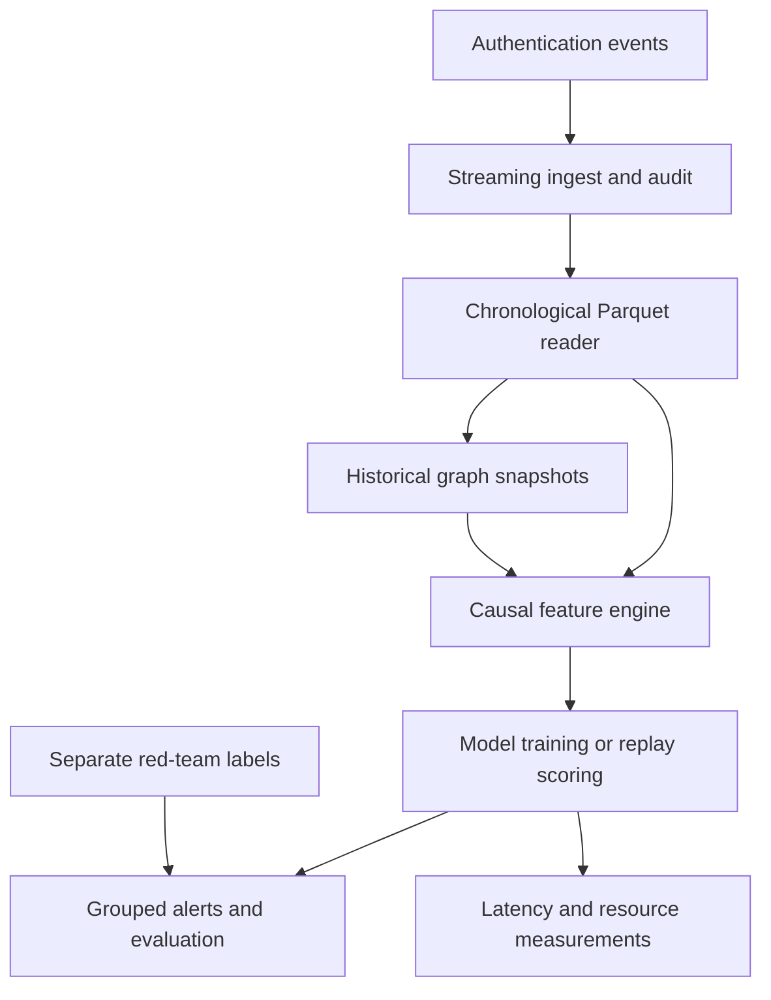

# Community-Aware Authentication Detection

A planned reproducible ML systems study of graph community features for authentication anomaly detection, with explicit measurement of detection quality, latency, memory, and graph maintenance cost.

**Status: initial package and CLI implemented; M0 in progress.** Two CLI integration tests passed in a fresh temporary environment using a non-editable installation, and Ruff lint and format checks passed. An intermittent import issue in the local editable installation remains unresolved. The detection pipeline and benchmarks are still planned. Last documentation update: 2026-10-17.

## Why this project?

Authentication events connect users and machines over time. Community structure may provide useful behavioral context, but maintaining that structure consumes resources and introduces stale features. This project will investigate whether that additional context is useful enough to justify its processing cost.

The central question is:

> Under measured CPU and memory constraints, how do community features, graph refresh frequency, and snapshot availability affect known-positive detection and end-to-end processing performance?

The project emphasizes causal feature computation, reproducibility, state management, failure recovery, and empirical tradeoffs.

## Relationship to existing work

LANL authentication anomaly detection, temporal graph lateral movement detection, and community-aware graph anomaly detection have existing implementations and research precedents, including Jbeil and ComGA. Seerflow documentation also describes Louvain community-crossing alerts.

Our intended contribution is a controlled implementation and evaluation of community features within a resource-measured authentication replay system. We do not claim a new Louvain/Leiden algorithm, scientific novelty, or superiority over existing systems.

See [Related work and attribution](docs/related_work.md) for six relevant projects, the scope of the comparison, source links, and code reuse rules. Those implementations have not been independently reproduced as part of this project.

## Planned experiment

| Variant | Method                                             | Purpose                         |
| ------- | -------------------------------------------------- | ------------------------------- |
| B0      | Deterministic novelty rule                         | Simple reference                |
| B1      | Isolation Forest with temporal behavioral features | Tabular ML baseline             |
| B2      | B1 plus host relationship and graph features       | Value of graph structure        |
| B3      | B2 plus Louvain community features                 | Value of community context      |
| B4      | B2 plus equivalent Leiden community features       | Alternative community algorithm |

All variants will use the same chronological splits, eligible event population, alarm grouping, and evaluation budgets. The initial graph window is 24 hours; the initial refresh interval is 1 hour. A focused follow-up will compare 15-minute, 1-hour, and 4-hour refresh schedules with other experimental controls fixed.

Each refresh-policy configuration will use matching causal training features. A frozen-model stale-snapshot stress test, if added, will be reported separately. An absence of quality improvement is a valid outcome.

## Planned architecture

V1 targets a single CPU machine using Python, uv, Parquet, DuckDB, scikit-learn, igraph/leidenalg, and a NetworkX Louvain reference. The plan does not require GPUs, Kafka, Kubernetes, a GNN, or a live corporate network.

## Data and evaluation limits

The real-data target is [LANL Cyber1](https://csr.lanl.gov/data/cyber1/), using `auth.txt.gz` and `redteam.txt.gz`. A small deterministic synthetic dataset will support development and CI. Obtain real data through the original provider and keep it outside Git.

Known red-team events are positives; unlabeled authentication events are not assumed to be verified benign. Label matching, ambiguous matches, unmatched labels, and evaluation eligibility will be audited and reported. Synthetic results and real-data results will remain separate.

The planned metrics are known-positive recall and alert yield at fixed alert budgets, label/eligibility coverage, online alarm rate, detection delay, throughput, latency percentiles, CPU consumption, peak memory, snapshot age, and snapshot computation cost. Retrospective daily top-B ranking and online thresholded alerts are distinct evaluations.

## Correctness and reliability requirements

- Features at event time `t` use only events strictly before `t`.
- All events sharing a timestamp are scored before any of them update state.
- Training and replay share one feature implementation.
- Labels cannot enter the feature or inference path.
- Community identifiers are not treated as numeric features or stable identities across snapshots.
- Operational replay uses a snapshot only after it has been computed and published.
- Checkpoint recovery must preserve logical outputs and state without double counting.
- State retention, all worker resources, and backlog must be measured; events must not be silently dropped.

These are acceptance criteria, not claims of tests already passing.

## Development roadmap

| Stage | Deliverable                                                         | Current status |
| ----- | ------------------------------------------------------------------- | -------------- |
| M0–M1 | Package, CLI, deterministic synthetic data, streaming ingest, audit | In progress; synthetic data and ingest not yet implemented |
| M2    | LANL adapter, label coverage audit, split decision                  | Planned        |
| M3–M4 | Causal features, baseline models, evaluation                        | Planned        |
| M5    | Graph snapshots and Louvain/Leiden ablations                        | Planned        |
| M6    | Operational replay, recovery tests, profiling                       | Planned        |
| M7    | Verified one-command demo, CI, documentation                        | Planned        |
| M8    | Real-data experiments and measured quality/cost report              | Planned        |

The implementation details, user checklist, Git workflow, and acceptance criteria are in [CODEX_PROJECT_START.md](CODEX_PROJECT_START.md), written in Turkish. The related-work review and this README are initial documentation deliverables; their existence does not complete the implementation milestones.

## Project status

The minimal `authgraph` package and CLI entry point are implemented. On Python 3.12.15, the CLI help and unknown-option integration tests passed after `uv sync --locked --no-editable` in a fresh temporary environment. Ruff 0.17.1 lint and format checks passed for `src` and `tests`.

The local editable installation has intermittently failed to import `authgraph` when its `.pth` file carries the macOS `hidden` flag. Removing the flag restored imports, but the process setting it has not been identified. The temporary-environment checks used the same machine and existing uv cache; another machine and an empty cache have not been tested.

M0 is not complete. Synthetic data generation, ingest, feature computation, models, and benchmarks remain unimplemented. See [verification notes and open questions](STATUS.md) for the recorded checks.

## Results and reproducibility

**No experimental results have been produced for this implementation.** When available, reports must include:

- Dataset identity/checksums, scope, time splits, and label coverage.
- Git revision, lockfile, configuration, seeds, and model/snapshot versions.
- Hardware, process/thread settings, workload size, replay mode, and input rate.
- Quality metrics and total system costs, including snapshot workers.
- Repeat counts, variation, failure cases, and any negative findings.
- Exact reproduction commands and links to sanitized output artifacts.

External repositories' published scores are not comparable baselines until their evaluation protocols have been reproduced and aligned.

## Attribution and licensing

Prior work and future code reuse are tracked in [docs/related_work.md](docs/related_work.md). No source code from those projects has been imported in preparing these documents. Before importing code, verify its exact license/version and retain required notices. Project code licensing will be selected before public release; do not assume a license from the visibility of a repository.

Data terms and dependency licenses are separate from the project's own code license. For LANL data, use the citation supplied by the provider: Alexander D. Kent, _Comprehensive, Multi-Source Cyber-Security Events_, 2015, DOI: [10.17021/1179829](https://doi.org/10.17021/1179829).
